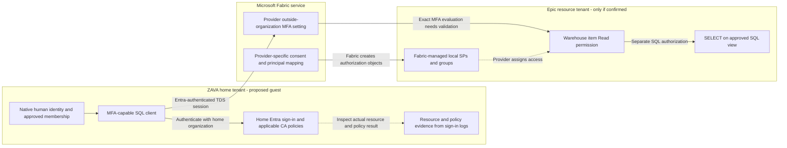

# Cross-Tenant Authorization and MFA

## Fabric SQL, Azure SQL, and Cosmos DB: what is enforced, where, and by whom

**Research date:** October 15, 2026.  
**Deployment labels:** ZAVA = proposed home/guest identity tenant; Epic = proposed provider/resource tenant. These labels reflect the proposed arrangement, not independently verified tenant ownership or configuration. ZAVA is a fictional organization label.

**Related deliverables:** [Microsoft workshop and test plan](./Microsoft-Validation-Workshop-and-Test-Plan.md), [MFA enforcement diagram](./04-cross-tenant-mfa-enforcement.svg), and [earlier Fabric architecture report](./Fabric-Cogito-Cross-Tenant-Access.md).

**Capture updated:** October 15, 2026. Section 11 consolidates the latest SQL/Cosmos cross-tenant MFA discussion with the earlier architecture research, diagrams, and Microsoft validation actions.

## Executive summary

MFA is evaluated through an identity authentication flow; a SQL server or Cosmos DB account does not acquire MFA protection merely because it resides in another tenant. First establish whether a client uses an Entra user token, an app/workload token, or a local credential such as a SQL login or Cosmos account key.[^sql-overview][^cosmos-rbac][^driver] The specific Fabric cross-tenant Warehouse feature documents home-tenant Conditional Access/MFA and provider-side authorization through Fabric-managed service principals/groups, plus a separate provider setting requiring MFA for outside-organization access.[^fabric-guest][^fabric-provider] That is not the same mechanism as classic Entra B2B guest access, where the resource tenant can require MFA and can optionally trust MFA completed in the home tenant.[^b2b-flow][^b2b-trust] Microsoft's generic Fabric guidance identifies five target-resource applications for Conditional Access, but the actual resources, claims, clients, and session behavior of this particular cross-tenant SQL path still require an evidence-based Microsoft/provider/customer validation.[^fabric-ca][^ca-troubleshoot]

## 1. Direct answer: how does MFA work for a resource in another tenant?

### The database's location is not the MFA policy

For an identity-based human connection, separate four questions:

1. **Who is the human?** Their home organization authenticates the identity.
2. **Which resource is the client requesting a token for?** Conditional Access targets Entra resources/applications, not simply the hostname typed into a database connection string.
3. **Which tenant evaluates which conditions?** This depends on the supported cross-tenant mechanism. Classic B2B and the Fabric mapping feature must not be treated as identical.
4. **What can the authenticated principal do?** SQL permissions or Cosmos data-plane roles are a separate authorization decision.[^resource-targeting][^b2b-flow][^fabric-provider][^cosmos-rbac]

An MFA prompt is not necessarily displayed on every database connection. A supported client may reuse a token/session with an already-satisfied MFA claim. Conversely, an MFA method being registered on a user account does not, on its own, prove that the actual database sign-in was governed by the required policy. Inspect the authentication and Conditional Access evidence for the relevant sign-in.[^driver][^signin-details]

### Comparison of the important access paths

| Path | Authentication and authorization | MFA implications |
|---|---|---|
| **Fabric Warehouse special cross-tenant access** | Guest authenticates with its home organization; Fabric creates provider-local representations and the provider grants item/SQL permissions. | Guest CA/MFA is documented. Provider has an additional outside-organization MFA setting. Exact resource targeting, claim handling, and session behavior need validation for the actual clients.[^fabric-guest][^fabric-provider] |
| **Azure SQL Database with a classic B2B human guest** | Resource-tenant guest object and database principal; external identity authenticates through Entra. | Resource CA can require MFA. Optional inbound MFA trust determines whether home-tenant MFA is accepted or resource-tenant MFA is required.[^sql-guests][^b2b-flow][^b2b-trust] |
| **Azure SQL native SQL login/password** | Database/server SQL authentication, not an Entra user-token flow. | Entra CA/MFA does not protect this authentication path. Where appropriate, Entra-only authentication is a separate service configuration, not a side effect of placing the resource in another tenant.[^sql-overview] |
| **Fabric SQL native SQL login/password** | Unsupported by the documented Fabric Warehouse/SQL analytics endpoint connectivity model. | It should not be offered as a way to avoid an Entra/MFA problem.[^fabric-connectivity] |
| **Entra username/password authentication** | Still Entra, but the noninteractive password/ROPC flow is different from native SQL authentication. | Cannot satisfy an MFA requirement. A connection-string password field does not make this an MFA-capable flow.[^fabric-auth][^driver] |
| **Cosmos DB for NoSQL with Entra data-plane RBAC** | Entra token plus Cosmos-native account/database/container data-role authorization. | An identity-based path is available, but supported external-user/token-tenant behavior and the actual CA coverage must be confirmed for the chosen cross-tenant client scenario.[^cosmos-rbac][^cosmos-explorer] |
| **Cosmos account-key connection** | Key-based authorization, not Entra user authentication. | No Entra MFA is performed by the key-based path. Disabling local authentication can remove that path, but does not make every remaining workload identity a human MFA session.[^cosmos-rbac] |
| **Service principal or managed identity** | Noninteractive workload identity, subject to the service's supported identity/tenant model. | No human MFA challenge. Use a separately approved workload-access policy, not a claim that human MFA was performed.[^sql-overview][^fabric-auth][^cosmos-rbac] |

**Example:** A human can complete MFA before SSMS gets a token and then use that token to access an authorized SQL database. An application holding a Cosmos account key can read data without performing that human Entra sign-in at all. These are different authentication paths, even when the resources sit in the same provider tenant.[^sql-overview][^cosmos-rbac]

## 2. Meeting assertions: confirmed, corrected, and unresolved

| Meeting assertion | Research assessment | Required confirmation |
|---|---|---|
| ZAVA remains the identity provider and manages membership. | **Supported for the generic Fabric feature.** Guest home-organization authentication and guest ownership of groups are explicit. | Verify ZAVA and Epic are actually using this feature, rather than B2B, a shortcut, a gateway, or another integration.[^fabric-guest][^fabric-provider] |
| Epic nests ZAVA groups in its own Entra groups. | **Not established as literal cross-directory nesting.** Fabric documents a mapping API, groups/SPs representing guest principals, and hourly group expansion. | Obtain the exact source object, generated provider objects, any additional provider-owned grouping, and direct/transitive-membership behavior. Do not substitute cross-tenant synchronization documentation as proof.[^fabric-provider] |
| Access is one-way rather than a broad bidirectional trust. | **Supported as an access-entitlement description.** Consent names a provider; provider grants access to its data. | Confirm there is no separate reciprocal integration. SQL results return to the client, so "one-way" does not mean a network data diode.[^fabric-guest][^fabric-provider][^fabric-connectivity] |
| B2B is necessarily a broad bidirectional trust. | **Correction:** B2B itself can be scoped by organization, users/groups, applications, and inbound/outbound settings. It is not an AD forest trust. | Identify the actual mechanism instead of using "B2B" as a synonym for unrestricted access.[^b2b-trust] |
| The SQL endpoint might accept ordinary SQL username/password credentials. | **Resolved for Fabric's documented SQL endpoint:** native SQL Authentication is unsupported. Entra password authentication is a different flow and cannot satisfy MFA. | Confirm actual item type, client authentication option, and driver version.[^fabric-connectivity][^fabric-auth][^driver] |
| MFA and device compliance will be enforced at ZAVA, then Epic authorizes the guest. | **Documented baseline for home CA/MFA, not proof of every control.** Device compliance must be an applicable enforced policy, not an assumed consequence of MFA. | Demonstrate actual target resource, policy result, device condition, and provider MFA behavior for each approved client.[^fabric-guest][^fabric-provider][^signin-details] |
| The Epic SQL endpoint should appear in ZAVA CA as its own application. | **Not established.** The endpoint is a network/database target; CA normally targets resource service principals. | Identify the real resource applications from sign-in/audience evidence. Do not search only for a per-Warehouse hostname.[^resource-targeting][^ca-troubleshoot] |
| Broad use should wait for Microsoft validation. | **Recommended release decision.** Documentation leaves deployment-specific questions open. | Require a written mechanism/resource-policy answer and passed non-PHI tests, not a verbal statement that MFA is enabled. |

The assessment above applies documented platform behavior to a proposed deployment. It does not certify Epic's actual configuration or any ZAVA policy.

## 3. Fabric-specific enforcement model

### What the two Fabric articles establish

- The guest authenticates using its own organization's Entra identity. The guest is responsible for its Conditional Access/MFA policies, and the provider article states those policies are enforced on guest sign-in.[^fabric-guest][^fabric-provider]
- Fabric creates service principals for mapped guest principals and groups representing guest groups in the **provider tenant**. Provider permissions are assigned to those local representations.[^fabric-provider]
- Guest groups remain guest-managed. Fabric performs group expansion hourly, so membership changes are not a live cross-directory nesting check on every SQL query.[^fabric-provider]
- Consent is a guest administrative operation naming a particular provider tenant. It is a prerequisite to mappings, not a permission grant to every provider Warehouse.[^fabric-guest][^fabric-provider]
- The guest needs the **provider-generated cross-tenant SQL connection string**, not the provider's ordinary same-tenant connection string.[^fabric-provider]

### Provider's additional MFA setting

Exact name:

> **Enforce multi-factor authentication on access requests from outside the organization**

Microsoft documents this as governing Fabric Warehouses and Lakehouse SQL analytics endpoints, **disabled by default**, applying to the **entire organization**, and configurable by Fabric administrators. It is distinct from the home tenant's CA policy.[^fabric-provider]

The existence of this setting does **not**, by itself, document:

- Which claim or validation process establishes that the original human satisfied MFA after identity projection.
- Which authentication strengths are recognized.
- Whether device compliance or an authentication context is transferred.
- Whether an existing token/session will be rechecked.
- How guest application/service-principal access behaves when the setting is enabled.

These are deliberately retained as Microsoft/provider validation questions, not assertions of either support or non-support. A provider-side service-principal sign-in log entry is not sufficient evidence of the original human's MFA.[^fabric-provider][^signin-details]

### Editable enforcement diagram

The proposed Epic/ZAVA labels are conditional. The arrows describe documented responsibilities, not a reverse-engineered token-exchange implementation.[^fabric-guest][^fabric-provider]

<!-- mermaid-checked: no \n, no em-dash/en-dash, no {} in labels, subgraphs are id["label"], arrows are -->|"label"|, all subgraphs closed by end, ids unique -->

## 4. Which application should ZAVA target in Conditional Access?

### Do not equate a SQL hostname with a separate CA enterprise application

Conditional Access resource targeting works with Entra resource applications/service principals. A client such as SSMS, the resource API it requests access to, a provider-managed projection SP, and a Warehouse hostname are four different things.[^resource-targeting][^app-objects]

| Object | Purpose | CA significance |
|---|---|---|
| SQL hostname / connection string | Routes a client to the intended endpoint/database. | Not evidence that this individual Warehouse is independently selectable as an application in ZAVA CA. |
| Client application | Tool requesting a token, such as SSMS or a driver/application. | Appears as the application/client in sign-in evidence; normally not the same as the resource being protected. |
| Resource application | API/service for which the token is requested. | The relevant CA resource/audience must be identified and covered. |
| Provider-generated mapping SP | Local Epic-side authorization representation, if Epic is the provider. | Does not become a ZAVA CA target merely because it represents a ZAVA user. |

The first row is a structural expectation rather than a product guarantee about this exact deployment. Validate it against actual resource/audience reporting; do not invent a Warehouse-specific CA app.[^resource-targeting][^ca-troubleshoot][^fabric-provider]

### The generic Fabric CA guidance now provides a concrete baseline

Microsoft's current Fabric CA documentation says to include these target resources:

1. **Power BI Service**
2. **Azure Data Explorer**
3. **Azure SQL Database**
4. **Azure Storage**
5. **Azure Cosmos DB**

It specifically says that existing Power BI policies should include the additional listed resources; otherwise CA might not operate as intended in Fabric.[^fabric-ca]

**This resolves one question:** a Power BI-only policy should not be assumed to cover all Fabric service access.

**It does not resolve every cross-tenant question:** this general page does not establish the exact audience sequence of the special guest-to-provider SQL mapping path, every supported SQL client, or how an original user's MFA signal is evaluated by the provider setting. Use the generic guidance as a baseline for the identity team, then verify the actual pilot sign-ins with Microsoft.[^fabric-ca][^fabric-guest][^fabric-provider]

The Fabric guest setup also explicitly requires guest-local enterprise applications for:

| Application | Published application ID |
|---|---|
| Power BI Service | `00000009-0000-0000-c000-000000000000` |
| Azure SQL Database | `022907d3-0f1b-48f7-badc-1ba6abab6d66` |

These are the feature's published prerequisites, **not proof that every client sign-in will target only those two resources**. Application IDs, local service-principal object IDs, and SQL item IDs must not be substituted for one another.[^fabric-guest][^app-objects]

### Log-based resource discovery

For each approved client, the ZAVA identity administrator should collect the matching sign-in evidence:

1. User, UTC time, sign-in type, home/resource tenant information, and status.
2. **Application/client** and **Resource/resource ID** separately.
3. Conditional Access policy results, including applicable audience reporting.
4. Authentication Details: method, success, and whether MFA was newly performed or satisfied by an earlier claim.
5. Device details and the result of any policy that actually requires a compliant device.

An enforced policy result is required for enforcement proof. Report-only evaluation is useful for staging but does not block a noncompliant connection. Device information alone does not prove a device-compliance grant control was required.[^signin-details][^ca-troubleshoot][^report-only]

Do not collect raw bearer tokens, passwords, account keys, or PHI as evidence. Use approved private support channels for necessary tenant/resource identifiers and diagnostic exports.

## 5. Classic Azure SQL B2B: where is MFA performed?

This section explains **classic B2B human access**, not Fabric's special managed-projection flow. Azure SQL documents external guest identities; Entra documents how resource-tenant MFA requirements interact with inbound trust.[^sql-guests][^b2b-flow]

Assume the resource tenant has an applicable CA policy requiring MFA:

| Resource-tenant inbound MFA trust | State of home-tenant MFA | Documented result |
|---|---|---|
| Enabled | A satisfactory home MFA claim already exists. | The resource tenant can accept that claim without a new MFA challenge. |
| Enabled | Home MFA has not yet been satisfied. | MFA challenge occurs in the home tenant as required. |
| Disabled / not configured | Home MFA may exist, but is not trusted through this setting. | B2B collaboration user must satisfy MFA in the **resource tenant** and may need to register an MFA method there. |

These cases come from the external-user authentication flow and inbound trust documentation. Home-tenant ownership of the primary identity does **not** mean MFA can only ever be registered or challenged in the home tenant.[^b2b-flow][^b2b-trust]

MFA trust, compliant-device trust, and hybrid-joined-device trust are separate settings. Trusting home MFA does not imply accepting a home compliant-device claim.[^b2b-trust]

**Do not copy this configuration into the proposed Epic Fabric flow without confirmation.** The special Fabric documentation explicitly distinguishes its model from B2B and does not direct administrators to the B2B inbound trust procedure.[^fabric-provider]

## 6. SQL authentication: resolve the ambiguous word "password"

| Client mode | Identity mechanism | Can satisfy human MFA? | Pilot decision |
|---|---|---|---|
| Native SQL login, for example `Authentication=Sql Password` | SQL-native credentials. | No Entra MFA flow. Fabric does not support it. | Reject for this Fabric design. |
| `ActiveDirectoryPassword` | Entra username/password, noninteractive password flow. | No; incompatible with mandatory MFA. | Do not weaken CA/MFA to make it work. |
| `ActiveDirectoryInteractive` / SSMS Microsoft Entra MFA option | Interactive Entra human authentication. | Designed to support MFA. | Baseline human-pilot path; record actual client/version. |
| `ActiveDirectoryServicePrincipal` | Application/workload authentication. | No human to challenge. | Separate workload review, not a human MFA exception. |

The mode distinctions are documented by the Fabric authentication/connectivity and SqlClient guidance. Fabric-specific guest guidance tells users to choose an MFA-capable Entra option.[^fabric-auth][^fabric-connectivity][^driver][^fabric-guest]

A `UID` or `PWD` field in a string is therefore not a sufficient diagnosis. Identify the authentication mode, token-acquisition path, and principal type. Do not infer success or failure from the presence of a password-shaped field alone.[^driver]

For the human pilot, use the exact provider-generated endpoint and the intended Warehouse initial database/catalog, not a guessed endpoint or an unqualified default database. Successful authentication is still not permission to query every table.[^fabric-provider][^fabric-connectivity]

## 7. Cosmos DB: what is known and what remains open?

### Verified for Azure Cosmos DB for NoSQL

- Cosmos has **native data-plane RBAC** for data operations, with data roles distinct from Azure management-plane roles.
- Entra identities can be granted data access at documented scopes.
- Account-key authentication is a separate local authentication path.
- The documented `disableLocalAuth` configuration disables key-based authorization and requires Entra authentication for that path; it does not make app-only identities perform human MFA.
- Data Explorer has an Entra data-plane authentication mode. Merely using the portal does not prove that every underlying data request used the intended Entra mode instead of a key-backed path.[^cosmos-rbac][^cosmos-explorer]

### Cross-tenant details not established by this research

The reviewed Cosmos-specific primary pages did not explicitly establish whether a B2B guest object can be assigned a native NoSQL data role and use the desired client/token-tenant path. They also did not establish the precise audience/CA-target mapping for this external-human scenario.

That is **not a statement that cross-tenant Cosmos access is unsupported**. It is a limit on the evidence available here. Confirm the following with the Cosmos identity/data-plane specialist before representing the path as MFA-enforced:

1. Supported external-user model and required issuer/tenant context.
2. Which local principal receives the Cosmos-native role assignment.
3. Actual resource application/audience visible in the user sign-in logs.
4. Whether the approved SDK/Data Explorer/client takes an MFA-capable path.
5. Whether key-based paths remain enabled and used by any application.
6. Separate control-plane and data-plane permissions and CA tests.

Do not use the Data Explorer website address as proof of the OAuth audience. Do not generalize this NoSQL analysis to every Cosmos API; verify each API's current authentication capabilities.[^cosmos-rbac][^cosmos-explorer]

### Why Azure portal MFA is insufficient evidence

Management access and database data access are different planes. An administrator completing MFA to manage an Azure account does not prove that a separate application using an account key, a SQL-native credential, or a workload identity performed human MFA for its data reads.[^cosmos-rbac][^sql-overview]

## 8. Evidence required before broad Fabric access

### Separate the evidence layers

| Evidence source | What it can establish | What it does not establish alone |
|---|---|---|
| ZAVA human sign-in, Authentication Details and CA results | Original user authentication, resource, applicable policy, satisfied/failed MFA, relevant device controls. | Epic item/table permissions or whether an already-open TDS session was terminated. |
| Epic-side service-principal sign-ins | Activity of the provider-managed representation described by the feature. | The original human's MFA strength or a guaranteed one-to-one cross-tenant correlation-ID match. |
| Fabric mapping and permission inventory | Approved relationship and projected-object access. | Runtime MFA for the particular user request. |
| Purview consent/mapping/token events | Administrative lifecycle and relevant Fabric activity. | The exact SQL rows accessed or the full human authentication chain. |
| SQL positive/negative test results | Actual allow/deny behavior for the approved item/view and prohibited access. | A complete CA policy evaluation without corresponding sign-in evidence. |

The evidence collection must combine these sources, not treat one provider SP sign-in as proof of all layers. The logs and event names are documented; end-to-end correlation for this special flow still needs Microsoft/product confirmation.[^signin-details][^signin-types][^fabric-provider]

Provider-side Purview names include **Created cross tenant auth mapping**, **Listed cross tenant auth mapping**, **Deleted cross tenant auth mapping**, **Created cross tenant auth token**, and **Clear Guest Tenant Data Cross Tenant Auth**. Guest events include **Consent Cross Tenant Auth** and **Revoke Consent Cross Tenant Auth**.[^fabric-provider]

### Timing and sessions

| Change | Documented behavior | Validation requirement |
|---|---|---|
| Guest group expansion / group-derived access | Hourly expansion; up to an hour for documented changes. | Test removal as well as addition; measure new access separately from existing sessions. |
| Provider `denyUserAccess` change | Login ability changes within an hour. | Existing sessions are unaffected. |
| Guest revokes provider consent | Access lost within a day. | Existing sessions are unaffected; not an instant session-kill control. |
| Provider deletes mapping | Associated groups/SPs stop working immediately; mapping metadata can remain listed for more than a day. | Do not infer that every already-open TDS session is killed; establish actual behavior. |
| Fabric CAE | Generic Fabric guidance states CAE session control is not supported. | Do not promise event-driven continuous session termination or a specific reauthentication interval without validation. |

These are documented behaviors, **not contractual SLAs**. Neither a generic access-token lifetime nor a sign-in-frequency policy should be represented as a proven maximum lifetime for every already-open SQL session.[^fabric-provider][^fabric-guest][^fabric-ca]

## 9. Recommended gates and Microsoft engagement

### Gate A - before establishing or changing the relationship

- Agree on the actual feature, provider/guest tenants, and owners.
- Obtain Microsoft agreement on the proposed auth/group/CA test design.
- Approve the tenant-consent action explicitly. Consent is provider-specific but tenant-level; do not inaccurately call it a per-pilot-group consent.
- Authorize only the controlled synthetic-data pilot mappings and permissions.
- Do not broaden production CA/trust settings or disable protections to make a connection succeed.

The consent, mapping, and permission operations are separate in the feature documentation. The gates here are recommendations, not claims of a built-in Microsoft approval workflow.[^fabric-guest][^fabric-provider]

### Gate B - before broad use

Require written Microsoft/provider clarification of unresolved product behavior, approved enforce-mode CA evidence for the actual clients, passed authorization-denial tests, acceptable session/offboarding behavior, and joint ZAVA/Epic sign-off.

The [workshop and test plan](./Microsoft-Validation-Workshop-and-Test-Plan.md) supplies the detailed agenda, evidence checklist, owner matrix, and test cases.

### Who should meet with Microsoft?

| Participant / route | Needed expertise |
|---|---|
| Microsoft Fabric Data Warehouse / SQL analytics endpoint support or engineering | This specific cross-tenant feature, provider enablement, mapped principals, provider MFA setting, SQL sessions. |
| Microsoft Entra Conditional Access / External Identities specialist | Correct resource targeting, human MFA/strength, device conditions, actual sign-in flow; distinction from B2B. |
| Microsoft Cosmos DB for NoSQL identity/data-plane specialist, if Cosmos is in scope | Supported external principals, native data roles, token tenant/audience, keys versus Entra, client behavior. |
| ZAVA Microsoft account/support coordination and ZAVA identity owner | Route the home-tenant CA/resource evidence and approve guest-side changes. |
| Epic Microsoft account/support coordination and Epic Fabric/identity owner | Route provider-side feature/MFA/authorization evidence and obtain product-group escalation. |

Use each organization's existing Microsoft account/support route and the official Fabric/Power BI support-ticket process, subject to entitlement. Ask for a linked cross-workload design-validation case rather than two unrelated answers from separate teams. The provider article's limited-preview form is an enrollment route, not a guaranteed incident-escalation contact.[^support][^fabric-provider]

No named Microsoft individuals were identified, and no ticket, outreach, or meeting was created. A current personal contact cannot be inferred from public product documentation.

## 10. Confidence Assessment

| Conclusion | Confidence | Boundary |
|---|---|---|
| Fabric's special cross-tenant model uses guest home authentication and provider-managed authorization objects. | High | Explicit in the supplied feature articles. |
| Literal cross-directory group nesting is the required implementation. | Not established | Docs describe mappings and expansion; require actual object-model confirmation. |
| Native SQL Authentication is unsupported for Fabric Warehouse/SQL endpoints. | High | Explicit connectivity restriction. |
| Entra password-only authentication can meet mandatory MFA. | No | Documented incompatibility; do not treat it as a fallback. |
| Generic Fabric CA should include the five named resources, not just Power BI. | High | Current generic Fabric CA guidance. |
| Exact audiences and provider interpretation of original human MFA for this deployed cross-tenant SQL flow. | Unresolved | Requires client-specific evidence and Microsoft confirmation. |
| Classic B2B resource tenant can accept home MFA or require resource-tenant MFA, depending on inbound trust. | High | Explicit Entra authentication-flow documentation. |
| Cosmos NoSQL supports Entra native data-plane RBAC and separately supports key authentication. | High | Cosmos-specific documentation. |
| The desired external Cosmos human/client/CA path is supported and fully MFA-enforced. | Not certified | No deployment-specific evidence or explicit guest-path confirmation obtained. |
| Actual Epic tenant ownership, enrollment, configuration, and ZAVA CA policies. | Not verified | No tenant access or private configuration was inspected. |

### Research scope and exclusions

This is public-documentation research, not a tenant security assessment or a live test result. No cloud sign-in, connection, permission change, consent, token acquisition, support escalation, or production test was performed. No customer identity records, private meeting text, credentials, account keys, raw tokens, or PHI were sent to public searches.

In evaluating research, generic OneLake shortcut instructions, cross-tenant synchronization group restrictions, and classic B2B inbound-trust procedures were **not** used as proof of the special Fabric Warehouse mapping implementation. Likewise, generic CAE timing was not substituted for documented SQL-session behavior.

## 11. Consolidated research record - October 15, 2026

This section captures the follow-up question, **"How are resources like SQL/CosmosDB living in another tenant handled in MFA?"**, alongside the earlier Fabric/Epic architecture research. It is a consolidated entry point; the detailed findings, citations, assumptions, and limitations above and in the linked architecture report remain applicable.

### Latest answer: resource location does not determine MFA

MFA is evaluated through the human's Entra authentication and applicable policies, not simply because a database lives in another tenant. A connection must first be classified as human Entra authentication, workload authentication, or a separate local-credential/key path. An already-satisfied MFA claim may avoid a new prompt; absence of a fresh prompt is not evidence that MFA was bypassed.[^sql-overview][^driver][^signin-details]

| Scenario | Captured conclusion | Boundary to preserve |
|---|---|---|
| Azure SQL with classic B2B human access | Resource-tenant CA can require MFA. With inbound MFA trust, home MFA may be accepted; without it, resource-tenant MFA can be required. | MFA trust and device-compliance trust are separate. This is not automatically the Fabric mapping flow.[^sql-guests][^b2b-flow][^b2b-trust] |
| Fabric special cross-tenant SQL access | Guest home CA/MFA is documented; provider permissions target Fabric-managed local representations. The provider also has an outside-organization MFA setting. | Validate actual resource audiences, original-human MFA handling, supported clients, and existing-session behavior.[^fabric-guest][^fabric-provider] |
| Cosmos DB for NoSQL with Entra | Native data-plane RBAC is separate from Azure management-plane authorization. | The desired external-human/token-tenant/CA path was not certified by this research; obtain Cosmos-specific confirmation.[^cosmos-rbac][^cosmos-explorer] |
| SQL-native password, Entra password-only, or Cosmos key | These are different mechanisms. Fabric rejects SQL-native authentication; Entra password-only cannot satisfy required MFA; Cosmos key access does not perform Entra MFA. | Do not use passwords or keys as a fallback to work around a failed identity/MFA test.[^fabric-connectivity][^fabric-auth][^driver][^cosmos-rbac] |
| Service principal or managed identity | Workload authentication does not perform an interactive human MFA challenge. | Approve workload access separately; do not label it as human MFA.[^sql-overview][^fabric-auth][^cosmos-rbac] |

### Earlier architecture findings retained

1. **Tenant roles are conditional.** Epic is the provider only if its tenant owns the Fabric analytical item; ZAVA is the guest/home tenant in the proposed model. Neither tenant ownership nor Epic's actual use of this feature was independently verified.[^fabric-guest][^fabric-provider]
2. **This is an access relationship, not an AD forest trust.** The provider-specific consent and mapping workflow does not itself establish reciprocal access. Classic B2B can also be narrowly scoped and should not be described as inherently broad or bidirectional.[^fabric-guest][^fabric-provider][^b2b-trust]
3. **Use "mapping/projection" rather than unverified "nesting."** Fabric documents provider-local groups/SPs and hourly group expansion, while the guest manages source membership. Literal cross-directory nesting and transitive-membership behavior still need confirmation.[^fabric-provider]
4. **Separate authentication from data permission.** A successful home sign-in or mapping does not grant all SQL data. The proposed narrow pilot uses item `Read` and an approved-view `SELECT` grant; its detailed implementation remains in the [architecture report](./Fabric-Cogito-Cross-Tenant-Access.md).[^fabric-provider]
5. **Keep the physical model and network caveat.** The earlier [physical deployment diagram](./02-physical-deployment.svg) distinguishes customer resource placement from Microsoft-operated Fabric SaaS. The [architecture report](./Fabric-Cogito-Cross-Tenant-Access.md), especially its Private Link discussion, retains the unresolved cross-tenant private-connectivity question; this MFA recap does not resolve it.
6. **Feature availability is asymmetric.** The guest article describes guest availability with limited providers; the provider article describes a limited preview. Do not represent the full provider workflow as unrestricted GA.[^fabric-guest][^fabric-provider]

### Conditional Access and release decision

The generic Fabric CA baseline names **Power BI Service, Azure Data Explorer, Azure SQL Database, Azure Storage, and Azure Cosmos DB**. Do not assume that a Power BI-only policy covers SQL access or that an Epic Warehouse hostname becomes a separate ZAVA CA application. Confirm the actual resource/audience and enforce-mode policy results for each client.[^fabric-ca][^resource-targeting][^ca-troubleshoot]

Before broad use, Microsoft, ZAVA, and Epic should jointly establish:

- The exact feature, tenant roles, group-object model, and supported human/workload identity paths.
- Which resources ZAVA must target, and evidence that required MFA strength and device controls actually apply.
- What the provider MFA setting validates and how it treats app-only guest access.
- Positive and negative SQL authorization outcomes, not merely a successful login.
- New, pooled, and already-open session behavior during membership removal, mapping deletion, and consent revocation.
- A supported network path and accepted operational/offboarding limits.

The [Microsoft workshop and test plan](./Microsoft-Validation-Workshop-and-Test-Plan.md) records the role-based escalation route, written questions, controlled pilot tests, evidence requirements, and release gates. It is **proposed, not Microsoft-approved or executed**. No named contact, meeting, support case, live tenant configuration, or MFA enforcement outcome is claimed here.

### Complete research and diagram navigation

| Existing artifact | What it preserves |
|---|---|
| [Original Fabric/Epic architecture research](./Fabric-Cogito-Cross-Tenant-Access.md) | Source-backed logical/physical architecture, conditional Epic mapping, practical implementation, API examples, Private Link gaps, and confidence assessment. |
| [Tenant architecture diagram](./01-tenant-architecture.svg) | Guest/provider ownership, identity mapping, SQL access, and management-plane separation. |
| [Physical deployment diagram](./02-physical-deployment.svg) | Guest network, logical directories, capacity example, and Microsoft-managed Fabric placement. |
| [Implementation swimlane](./03-implementation-swimlane.svg) | Guest, provider, and service responsibilities from setup through validation. |
| [MFA enforcement diagram](./04-cross-tenant-mfa-enforcement.svg) | Home authentication/CA, provider authorization, separate MFA gate, and validation gaps. |
| [Microsoft workshop and test plan](./Microsoft-Validation-Workshop-and-Test-Plan.md) | Escalation roles, agenda, product questions, evidence worksheet, tests, and no-go conditions. |

**Confidence remains unchanged:** documented platform behavior is distinguished from proposed design choices, unresolved product questions, and unverified deployment facts. No additional web research or live authentication testing was performed for this capture update.

## Sources

[^fabric-guest]: Microsoft Learn, [Set Up Cross-Tenant Access for Guest Tenants](https://learn.microsoft.com/en-us/fabric/enterprise/cross-tenant-access), "How does it work?", "Providing consent", "Responsibilities of the guest", "Install applications", "Access the cross-tenant data warehouse", and availability/known-issue notes.
[^fabric-provider]: Microsoft Learn, [Set Up Cross-Tenant Access for Providers](https://learn.microsoft.com/en-us/fabric/enterprise/cross-tenant-access-for-providers), "How it works", provider responsibilities, mapping APIs, permission grants, connection strings, governance, outside-organization MFA, and restrictions/considerations.
[^fabric-ca]: Microsoft Learn, [Conditional Access in Fabric](https://learn.microsoft.com/en-us/fabric/security/security-conditional-access), "Best practices for Fabric Conditional Access policies" and policy setup: five resource applications, Power BI policy warning, and CAE non-support.
[^fabric-connectivity]: Microsoft Learn, [Warehouse connectivity](https://learn.microsoft.com/en-us/fabric/data-warehouse/connectivity), authentication, initial catalog, MSSQL/TDS connectivity, and "Considerations and limitations".
[^fabric-auth]: Microsoft Learn, [Microsoft Entra authentication as an alternative to SQL authentication](https://learn.microsoft.com/en-us/fabric/data-warehouse/entra-id-authentication), authentication modes, driver support, and Fabric configuration.
[^driver]: Microsoft Learn, [Microsoft Entra authentication with SqlClient](https://learn.microsoft.com/en-us/sql/connect/ado-net/sql/azure-active-directory-authentication), SQL versus Entra password authentication, interactive authentication, deprecated password mode/MFA incompatibility, and credential/token caching guidance.
[^sql-overview]: Microsoft Learn, [Microsoft Entra authentication with Azure SQL](https://learn.microsoft.com/en-us/azure/azure-sql/database/authentication-aad-overview?view=azuresql), identity types, multifactor authentication, and Entra versus SQL authentication.
[^sql-guests]: Microsoft Learn, [Create and use Microsoft Entra guest users in Azure SQL](https://learn.microsoft.com/en-us/azure/azure-sql/database/authentication-aad-guest-users?view=azuresql), resource-tenant guest users and external-provider database access.
[^b2b-flow]: Microsoft Learn, [Authentication and Conditional Access for External ID](https://learn.microsoft.com/en-us/entra/external-id/authentication-conditional-access), external Microsoft Entra user authentication-flow table, home/resource MFA challenges, and resource-tenant MFA registration when trust is not configured.
[^b2b-trust]: Microsoft Learn, [Configure cross-tenant access settings for B2B collaboration](https://learn.microsoft.com/en-us/entra/external-id/cross-tenant-access-settings-b2b-collaboration), inbound/outbound scope and "To change inbound trust settings for MFA and device claims".
[^resource-targeting]: Microsoft Learn, [Conditional Access: target resources](https://learn.microsoft.com/en-us/entra/identity/conditional-access/concept-conditional-access-cloud-apps), Microsoft cloud applications/service principals and client-versus-resource targeting.
[^ca-troubleshoot]: Microsoft Learn, [Troubleshooting Conditional Access](https://learn.microsoft.com/en-us/entra/identity/conditional-access/troubleshoot-conditional-access), sign-in investigation, policy results, and audience reporting.
[^signin-details]: Microsoft Learn, [Sign-in log activity details](https://learn.microsoft.com/en-us/entra/identity/monitoring-health/concept-sign-in-log-activity-details), basic information, authentication details, Conditional Access, device information, and correlation identifiers.
[^signin-types]: Microsoft Learn, [What are Microsoft Entra sign-in logs?](https://learn.microsoft.com/en-us/entra/identity/monitoring-health/concept-sign-ins), interactive/noninteractive user, service-principal, and managed-identity sign-in categories.
[^report-only]: Microsoft Learn, [Conditional Access report-only mode](https://learn.microsoft.com/en-us/entra/identity/conditional-access/concept-conditional-access-report-only), report-only evaluation versus enforcement.
[^cosmos-rbac]: Microsoft Learn, [Use role-based access control with Azure Cosmos DB for NoSQL](https://learn.microsoft.com/en-us/azure/cosmos-db/how-to-connect-role-based-access-control), native data-plane versus control-plane access, role assignment/scope, and disabling local authentication.
[^cosmos-explorer]: Microsoft Learn, [Azure Cosmos DB Data Explorer](https://learn.microsoft.com/en-us/azure/cosmos-db/data-explorer), "Use with Microsoft Entra authentication" and NoSQL data-operation authentication mode.
[^app-objects]: Microsoft Learn, [Application and service principal objects in Microsoft Entra ID](https://learn.microsoft.com/en-us/entra/identity-platform/app-objects-and-service-principals), application objects, tenant-local service principals, and multitenant relationships.
[^support]: Microsoft Learn, [Create a support ticket for Power BI and Fabric](https://learn.microsoft.com/en-us/power-bi/support/create-support-ticket), supported ticket creation, eligibility, workload selection, and support-plan routing.
