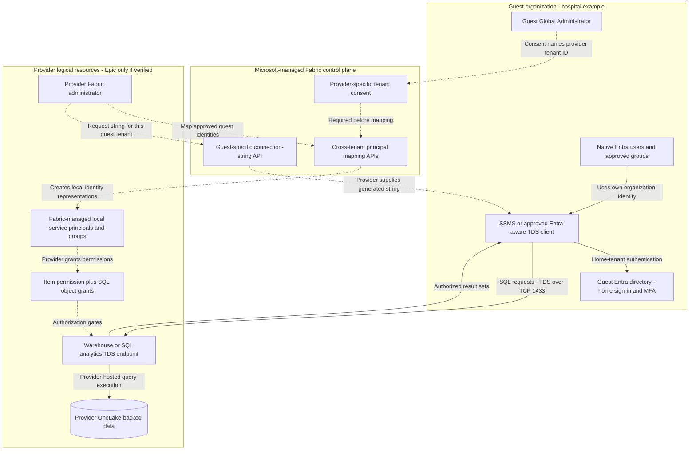
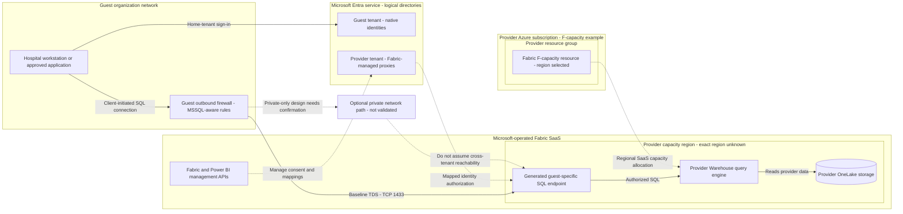
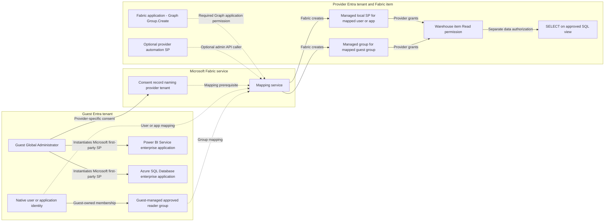
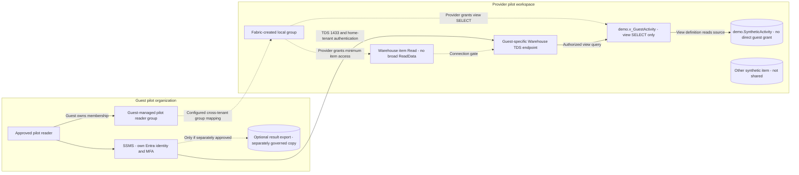
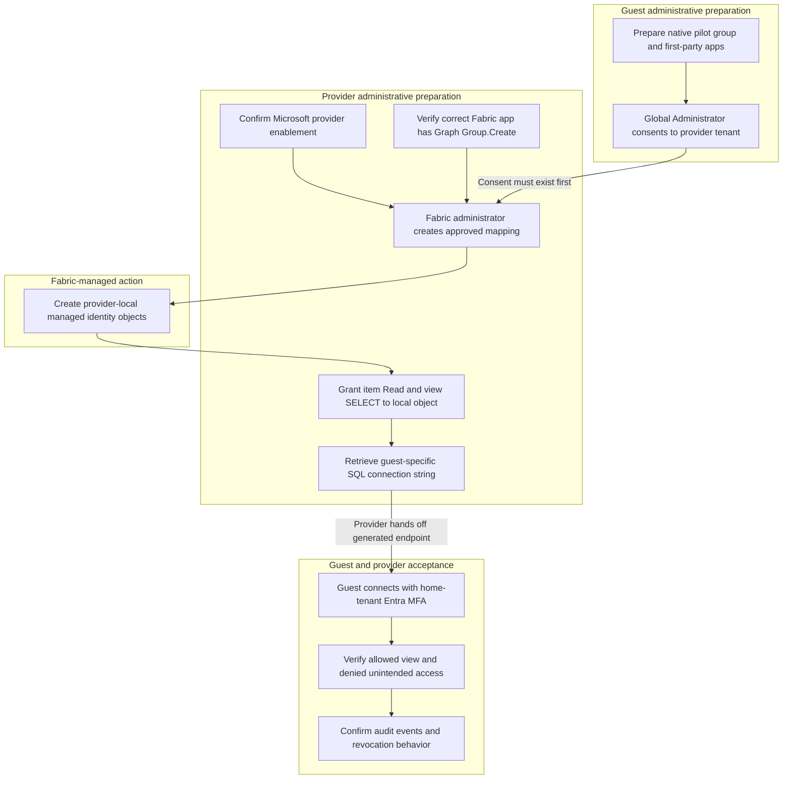

# Microsoft Fabric Cross-Tenant SQL Access

## Architecture and practical Epic Cogito Cloud reference design

**Research snapshot:** October 15, 2026.  
**Scope:** The two supplied Microsoft Learn articles, their relevant Microsoft platform/API references, and public evidence about the proposed Epic relationship.  
**Important:** This is a documented Fabric architecture with a **conditional Epic example**, not a verified drawing of Epic's production environment.

**Implementation follow-up (October 16, 2026):** [Four ARM/Bicep deployment combinations](./infra/README.md)
and the [architecture decision record](./infra/ARCHITECTURE.md) now distinguish
Azure-only/customer-Fabric consumers and public/workspace-private SQL paths.
The decision record adds Microsoft's explicit cross-tenant **workspace-level**
Private Link procedure; retain this report's separate identity, DNS, runtime, and
provider-validation gates rather than generalizing tenant-level restrictions.

## Executive summary

The supplied articles describe cross-tenant **SQL access to provider-hosted Fabric Warehouses and SQL analytics endpoints**, using a guest organization's own Microsoft Entra identities. Fabric creates provider-side identity representations, and the provider grants those representations access to the relevant data; this is explicitly different from both B2B guest-user collaboration and OneLake external data sharing.[^guest-overview][^provider-model] If Epic hosts the relevant Cogito Cloud warehouse in an Epic-controlled Fabric tenant, **Epic would be the provider and the hospital's Entra tenant would be the guest**, but neither supplied article establishes that Epic actually uses this feature.[^provider-model][^epic-direction] The source warehouse remains provider-hosted, while SQL results travel to the guest client; this must not be interpreted as a guarantee that clients cannot export or retain results.[^provider-model][^connectivity] Guests do not need their own Fabric deployment for this access pattern, whereas provider participation remains gated: Microsoft describes the guest capability as generally available but the provider capability as a limited preview.[^guest-overview][^provider-model]

## Diagram and artifact guide

The SVG drawings are self-contained vector images: they can be opened without a Mermaid renderer. The Mermaid blocks below provide editable architecture source.

| Artifact | Contents |
|---|---|
| [01-tenant-architecture.svg](./01-tenant-architecture.svg) | Two-tenant ownership, identity mapping, SQL request/result paths, and management-plane separation. |
| [02-physical-deployment.svg](./02-physical-deployment.svg) | Guest network, Entra directories, an illustrative Azure F-capacity control resource, and Microsoft-managed regional Fabric compute/storage. |
| [03-implementation-swimlane.svg](./03-implementation-swimlane.svg) | Guest, Fabric-service, and provider responsibilities from enrollment through least-privilege validation. |
| This report | Six editable Mermaid diagrams, implementation examples, API distinctions, operational timing, source references, and explicit uncertainties. |

---

## 1. Does one tenant represent Epic Cogito Cloud?

### The answer is conditional, not confirmed

**Yes, that is a plausible mapping if Epic owns the tenant containing the Fabric analytical data.** The definition of *provider* is determined by where the Fabric Warehouse/SQL analytics endpoint is hosted, not by which company supplies the EHR software. The guest is the organization whose native identities are being allowed to query that provider-hosted data.[^guest-overview][^provider-model]

Public consulting material from RSM discusses Epic's evolution toward Cogito Cloud and Microsoft Fabric-based analytics. That supports investigating the proposed architecture, but it is **secondary evidence about product direction**, not proof of Epic's tenant ownership, preview enrollment, physical deployment, or use of this particular cross-tenant feature. Neither supplied Microsoft Learn article names Epic.[^epic-direction][^guest-overview][^provider-model]

| Actual operating arrangement | Correct interpretation |
|---|---|
| Epic owns the Fabric tenant hosting the hospital's analytical warehouse. | **Conditional reference model used here:** Epic = provider; hospital = guest. |
| The hospital owns the Fabric tenant, even if Epic helps operate the service. | The hospital is the resource/provider tenant. A hospital user in that same tenant would not need this feature merely because the software is Epic. |
| Data is shared into the hospital's OneLake through external data sharing/shortcuts. | A different Fabric mechanism; do not substitute the SQL access architecture in this report. |

The first two rows are applications of Microsoft's tenant-role definitions, not assertions about a particular Epic deployment; the third follows Microsoft's explicit distinction between these features.[^guest-overview][^provider-model]

### Terminology that matters

- **Guest tenant does not mean a B2B guest account.** The guest's ordinary home-organization identities are used; Fabric manages corresponding provider-side service principals/groups rather than requiring the provider to manage individual B2B guest users.[^provider-model]
- **An Entra tenant is not an Azure subscription or a VNet.** The drawings distinguish identity ownership from Azure resource placement and Microsoft-operated SaaS infrastructure.[^entra-objects][^capacity][^fabric-security]
- **Cogito is an analytics umbrella, not a single confirmed database deployment.** A public UC Davis Health glossary includes reporting tools and the Clarity, Caboodle, and Chronicles data stores under Cogito. That terminology alone does not establish a cloud ingestion pipeline or a Fabric tenant topology.[^cogito-terms]
- **No Epic regions, tenant GUIDs, capacity SKUs, network addresses, customer-isolation implementation, or ingestion jobs are claimed here.** Those are deployment-specific confirmations still required.

## 2. Application Architecture

### Diagram 1 - Logical two-tenant architecture

**How to read this:** Solid SQL arrows are runtime access; dotted arrows describe identity/administrative relationships. The Epic label is an example assumption. The guest-specific connection string is obtained by the provider, not synthesized by the guest.[^provider-model][^provider-mapping][^provider-connection]

<!-- mermaid-checked: no \n, no em-dash/en-dash, no {} in labels, subgraphs are id["label"], arrows are -->|"label"|, all subgraphs closed by end, ids unique -->


**What this drawing does not mean:** The tenant consent is not a network tunnel, the provider-side service principal is not a B2B user, and the guest does not receive a OneLake shortcut from this SQL feature. A guest can nevertheless create a separate data copy by saving or importing SQL results; client-side data handling must be governed separately.[^provider-model][^connectivity]

### Technology Stack Summary

| Layer | Technology | Version / interface | Purpose |
|---|---|---|---|
| Identity | Microsoft Entra ID | Microsoft-managed service | Guest home sign-in and provider-side identity objects.[^guest-overview][^entra-objects] |
| Guest app enablement | Microsoft Graph | `/v1.0/servicePrincipals` | Instantiate the two specified Microsoft first-party enterprise applications in the guest directory.[^guest-install] |
| Tenant trust | Power BI service REST endpoint | `/v1/ephemeral/crosstenantauth/consent` | Record guest consent for a named provider tenant.[^guest-consent] |
| Principal projection | Fabric admin REST endpoints | `/v1/admin/crosstenantauth/mappings` | Create, list, and remove cross-tenant mappings.[^provider-mapping] |
| Data access | Fabric Warehouse / SQL analytics endpoint | TDS, TCP 1433 | Authenticate and execute SQL against provider-hosted data.[^provider-model][^connectivity] |
| Storage | OneLake | Microsoft-managed Fabric storage | Underlying provider-side storage; not direct guest file access in this design.[^onelake][^provider-model] |
| Capacity | Existing supported Fabric capacity; F capacity shown as an example | `Microsoft.Fabric/capacities` for Azure F SKUs | Regional compute allocation; the drawing does not prescribe a SKU.[^capacity][^fabric-security] |
| Governance | Purview Audit and Entra logs | Microsoft-managed services | Consent/mapping events, sign-ins, and directory activity.[^provider-governance] |

### Data Storage and External Services

The provider's Fabric workspace contains the analytical item. General Fabric architecture places backend compute and customer-data storage in the capacity region; OneLake is managed by Fabric and does not require the provider to provision a separate customer storage account for the Warehouse. The guest client crosses the tenant boundary to query the SQL endpoint, not to mount the underlying OneLake files.[^fabric-security][^onelake][^provider-model]

### Key Architectural Decisions

1. **Keep home identities under guest control.** The guest manages users/group membership and its Conditional Access/MFA; the provider controls what its projected identities can access.[^guest-overview][^provider-model]
2. **Separate tenant trust, identity projection, item access, SQL authorization, and network reachability.** Success at one gate does not establish success at the others.[^guest-consent][^provider-mapping][^sql-permissions][^connectivity]
3. **Use item-level access for a narrowly scoped reader.** Whole-workspace Viewer and Warehouse `ReadData` can be broader than a single curated-view requirement.[^share-permissions][^warehouse-roles]

## 3. Physical deployment and network relationships

### Diagram 2 - Physical/service placement

This is a **deployment-boundary diagram**, not a claim to know Microsoft's internal server topology or Epic's datacenter layout. The Azure subscription/resource-group section is an **F-capacity example**; the actual Warehouse engine and OneLake storage are Microsoft-operated Fabric SaaS, not customer SQL Server VMs inside that resource group.[^capacity][^fabric-security][^onelake]

**Baseline pilot assumption:** The provider permits the standard/public TDS path from the guest's approved network. If the provider requires private-only access, the private-path issue in Section 7 must be resolved before using this baseline.[^connectivity][^private-link][^provider-connection]

<!-- mermaid-checked: no \n, no em-dash/en-dash, no {} in labels, subgraphs are id["label"], arrows are -->|"label"|, all subgraphs closed by end, ids unique -->


### Component location inventory

| Component | Ownership / placement | What must not be inferred |
|---|---|---|
| Guest workstation/application | Hospital-owned client environment; its own network controls. | It is not a Fabric capacity and is not physically inside the Entra directory.[^guest-overview] |
| Guest Entra directory | Hospital identity boundary. | No second hospital Fabric deployment is required merely to use this SQL access pattern.[^provider-model] |
| Provider Entra directory | Provider's identity boundary; Fabric-managed proxy SPs/groups reside here. | Do not manually create B2B equivalents or issue credentials for these managed objects.[^provider-model][^provider-governance] |
| F-capacity resource, if used | Provider-associated Azure subscription, resource group, and selected Azure region. | The ARM resource does not mean customer-managed SQL servers/storage accounts must be deployed.[^capacity][^fabric-security] |
| Fabric workspace | Provider's logical item container, assigned to capacity. | Separate workspaces do not, by themselves, establish dedicated physical hardware.[^onelake][^fabric-security] |
| Warehouse engine and OneLake | Microsoft-managed backend capacity platform and storage, associated with the capacity region. | Exact machines, availability zones, Epic SKU, and Epic region are not public facts established here.[^fabric-security][^onelake] |
| Fabric metadata/control services | Microsoft-managed SaaS; general Fabric architecture distinguishes tenant-home-region metadata from capacity-region data processing. | Do not assume metadata and data necessarily share one region in a multi-geo deployment.[^fabric-security] |
| Epic source ingestion | Not established by either supplied article. | No Chronicles-to-Clarity-to-Caboodle-to-Fabric pipeline, extraction cadence, or source network path is asserted. |

### Network-flow matrix

| Flow | Endpoint / protocol | Identity and implementation significance |
|---|---|---|
| Client authenticates to its own organization | Entra sign-in; use the client's supported Entra flow. | Home-tenant MFA/Conditional Access remains relevant; no custom token exchange is implemented in this report.[^guest-overview][^entra-auth] |
| Guest admin installs first-party enterprise apps | Microsoft Graph REST over HTTPS. | Guest-tenant administrative session; creates local service-principal instances, not new custom applications.[^guest-install][^entra-objects] |
| Guest admin consents/revokes | `api.powerbi.com`, HTTPS; standard HTTPS port 443. | Guest Global Administrator and documented `Tenant.ReadWrite.All` scope.[^guest-consent] |
| Provider manages mappings | `api.fabric.microsoft.com`, HTTPS. | Provider Fabric administrator; service-principal automation has additional enablement prerequisites.[^provider-mapping][^admin-sp] |
| Provider retrieves connection string | Fabric Warehouse or SQLEndpoint REST API, HTTPS. | Provider-side caller retrieves the guest-specific endpoint; this is not a guest entitlement to Fabric public APIs.[^provider-connection][^warehouse-api][^sqlendpoint-api][^provider-limits] |
| Guest queries provider | Generated endpoint, **TDS over TCP 1433**. | Inspect as MSSQL/TDS, **not HTTPS on port 1433**; SQL Authentication is not supported.[^connectivity] |
| Query results return | The SQL session's result stream. | Results cross to the client; subsequent export/import is a separate data-handling operation.[^connectivity] |

For restrictive firewalls, use the current Warehouse connectivity guidance, including the relevant Power BI/SQL service tags or documented SQL-aware Azure Firewall handling. Plain endpoint-FQDN allow-listing alone is not the general documented solution. Regional rules can require tenant-home, capacity, and paired-region coverage; obtain the provider's actual regional information rather than guessing Epic's geography.[^connectivity]

## 4. Component Relationships

### Diagram 3 - Distinguish the identity objects

The most common implementation mistake is treating every service principal in the design as the same object. There are **guest-local Microsoft first-party enterprise applications**, **Fabric-managed provider-side projections**, and, optionally, a **provider-owned automation application**. Their ownership and purposes are different.[^guest-install][^entra-objects][^provider-mapping][^provider-governance]

<!-- mermaid-checked: no \n, no em-dash/en-dash, no {} in labels, subgraphs are id["label"], arrows are -->|"label"|, all subgraphs closed by end, ids unique -->


### Component Inventory

| Component | Layer / type | Responsibility and constraint |
|---|---|---|
| Guest native principal | Identity; user, group, or service principal | Remains managed by the guest organization.[^guest-overview][^provider-model] |
| Power BI Service / Azure SQL Database local SPs | Guest enterprise applications | Instantiate Microsoft's specified applications; these are not per-guest provider projections.[^guest-install] |
| Provider's Fabric application | Service identity | Requires Microsoft Graph **application** permission `Group.Create`; the feature documentation does not identify its exact app ID, so do not grant permissions to a guessed app.[^provider-mapping][^graph-permissions] |
| Provider-side managed SP/group | Identity projection | Fabric creates it from a mapping; provider assigns access to this local object.[^provider-mapping][^provider-permissions] |
| Optional provider automation SP | Management caller | Separate provider-controlled identity; not necessary for a human-admin pilot.[^provider-mapping][^admin-sp] |
| Warehouse permission | Fabric item access | `Read` allows connection; it is not equivalent to permission to read all SQL data.[^share-permissions][^sql-permissions] |
| SQL object grant | Data authorization | A curated-view `SELECT` grant can provide a smaller read surface than Warehouse `ReadData`.[^sql-permissions][^share-permissions] |

**Do not manually modify/delete Fabric's generated identity applications or app registrations.** Use the mapping-management APIs for removal.[^provider-governance]

### Identifier crosswalk

| Identifier | Meaning / use |
|---|---|
| Provider tenant GUID | Sent as `resourceTenantObjectId` by the guest consent/revoke calls.[^guest-consent] |
| Guest tenant GUID | Sent as `tenantId` in mapping requests and `guestTenantId` when retrieving the cross-tenant connection string.[^provider-mapping][^provider-connection] |
| Guest user/group/SP object ID | Directory object in the guest tenant being mapped. For an app, the provider sample explicitly uses the **Enterprise application object ID**, not its application/client ID.[^provider-mapping] |
| Mapping ID | The actual mapping identifier used for deletion; do not assume it equals a guest object ID.[^provider-mapping] |
| Provider projected-object ID/name | The **different local object** to which provider item/SQL permissions are assigned; resolve it from the actual mapping/Fabric/Entra objects, not an invented naming convention.[^provider-permissions][^provider-governance] |
| Workspace and Warehouse IDs | Provider-side Fabric resource identifiers for the Warehouse connection-string route.[^warehouse-api] |
| SQL endpoint ID | The SQL analytics endpoint's own ID for the separate `/sqlEndpoints/` route; do not substitute its parent Lakehouse ID.[^sqlendpoint-api] |

### Diagram 4 - Runtime authentication and authorization

This flow deliberately abstracts Fabric's internal token processing. The documentation establishes home-organization sign-in and provider-side mappings, but not enough detail to justify inventing an internal OAuth exchange or custom token broker.[^guest-overview][^provider-model]

```mermaid
flowchart LR
    dOpen["1 - Open supplied guest-specific SQL endpoint"]
    dAuth["2 - Complete guest home-tenant sign-in"]
    dTds["3 - Establish Entra-authenticated TDS session"]
    dMapping["4 - Resolve configured provider-side mapping"]
    dItem["5 - Check Fabric item access"]
    dSql["6 - Check SQL permissions on requested object"]
    dResult["7 - Return authorized rows to guest client"]

    dOpen --> dAuth
    dAuth -->|"Guest MFA and Conditional Access"| dTds
    dTds --> dMapping
    dMapping -->|"Provider MFA requirement if enabled"| dItem
    dItem --> dSql
    dSql --> dResult
```

<!-- mermaid-checked: no \n, no em-dash/en-dash, no {} in labels, subgraphs are id["label"], arrows are -->|"label"|, all subgraphs closed by end, ids unique -->


A human pilot should use the documented Entra MFA-capable client authentication. Do not enable SQL username/password authentication or turn off MFA merely to make a test connect. Guest service-principal mappings exist, but a successful provider managed-identity call to the connection-string API does **not** establish that guest managed-identity SQL sign-in is supported by this feature.[^guest-overview][^provider-mapping][^provider-connection][^entra-auth][^connectivity]

## 5. Practical implementation reference

### Explicit assumptions for the worked example

The following are **design choices**, not Epic product facts:

- The provider is already accepted/enabled by Microsoft for this feature.
- A provider-owned workspace contains a **dedicated synthetic pilot Warehouse**, `wh_guest_pilot`.
- The guest controls an approved Entra group, `grp-fabric-pilot-readers`.
- One pre-approved client workstation can reach the provider-approved TDS endpoint.
- The example contains **only fabricated operational counts, no PHI and no Epic schema**.
- The provider uses a supported SQL-governed permission model for this Warehouse pilot; Lakehouse SQL endpoints need their own security-mode review.

The provider-preview, identity, connectivity, and SQL-permission prerequisites behind these choices are documented; the names and sample data are illustrative.[^provider-model][^provider-mapping][^connectivity][^sql-permissions]

### Diagram 5 - Concrete least-privilege pilot

The group and item boundaries below are logical access boundaries, **not a claim that Epic physically dedicates a server or capacity to each hospital**. Optional downstream storage is shown separately because importing results creates a new copy and is not part of this access feature.[^provider-model][^fabric-security][^connectivity]

<!-- mermaid-checked: no \n, no em-dash/en-dash, no {} in labels, subgraphs are id["label"], arrows are -->|"label"|, all subgraphs closed by end, ids unique -->


`Read` is the item-level connect permission; `ReadData` reads all Warehouse tables/views. For this pilot, avoid a workspace Viewer assignment and avoid "Read all data using SQL"; grant item `Read` plus `SELECT` only on the intended view. Tests must confirm that direct base-table and unrelated-item access are denied. Other existing memberships/grants must be checked because a narrow new grant does not remove pre-existing broad access.[^share-permissions][^sql-permissions][^warehouse-roles]

### Diagram 6 - Deployment and handoff sequence

The important dependency is **guest consent before provider mapping**. Provider enablement and Graph prerequisites are separate prerequisites; provider permissions and the guest-specific connection-string handoff are separate from creating a mapping.[^guest-consent][^provider-mapping][^provider-permissions][^provider-connection]

<!-- mermaid-checked: no \n, no em-dash/en-dash, no {} in labels, subgraphs are id["label"], arrows are -->|"label"|, all subgraphs closed by end, ids unique -->


### Implementation checklist and ownership

| Step | Owner | Action | Required evidence |
|---|---|---|---|
| 0 | Provider + Microsoft | Confirm provider enrollment/enablement and target Warehouse availability. | Provider acceptance, correct tenant/resource identifiers, regional/network posture.[^provider-model] |
| 1 | Provider identity administrator | Verify the correct Fabric application's Graph `Group.Create` **application** permission. Do not guess its identity from a similar display name. | Correct local service-principal identification and recorded permission grant.[^provider-mapping][^graph-permissions] |
| 2 | Guest administrator | Prepare approved native users/group and verify/install the two prescribed Microsoft first-party enterprise apps. | Guest object IDs and first-party app IDs verified in the correct tenant.[^guest-install][^first-party-verification] |
| 3 | Guest Global Administrator | Consent to the specific provider tenant with the documented scope. | Correct `resourceTenantObjectId` and a successful consent operation.[^guest-consent] |
| 4 | Provider Fabric administrator | Create the guest principal/group mapping. | Successful mapping; actual managed provider-side object identified.[^provider-mapping] |
| 5 | Provider data owner | Share only the pilot Warehouse with item `Read`; grant intended SQL view access. | No unintended Viewer/ReadData or other inherited broad access.[^provider-permissions][^share-permissions][^sql-permissions] |
| 6 | Provider authorized caller | Retrieve the connection string for the guest tenant and appropriate item type. | Actual returned string plus Warehouse database name; no guessed hostname.[^provider-connection][^warehouse-api][^sqlendpoint-api] |
| 7 | Guest network/client owner | Allow approved Entra/control-plane dependencies and MSSQL/TDS connectivity. | Real connection from the approved workstation; provider-approved public/private posture.[^connectivity] |
| 8 | Guest reader | Connect using own Entra identity and MFA; specify the intended initial database/catalog. | Read-only synthetic query succeeds only where authorized.[^guest-overview][^connectivity] |
| 9 | Both organizations | Exercise negative access, audit, membership propagation, and offboarding tests. | Recorded outcomes against Section 8, not merely a successful login.[^provider-governance][^provider-limits] |

### API and SQL examples

**These are documentation-derived requests and an illustrative pilot, not a tested end-to-end deployment script.** No cloud resources, identities, or live data were created or queried for this research. Replace placeholders and validate current preview instructions before execution.

#### A. Guest: instantiate the specified Microsoft first-party enterprise applications

The feature's own "Install applications" table specifies these application IDs:[^guest-install]

| Microsoft application | Application ID to instantiate in guest tenant |
|---|---|
| Power BI Service | `00000009-0000-0000-c000-000000000000` |
| Azure SQL Database | `022907d3-0f1b-48f7-badc-1ba6abab6d66` |

In the **guest** tenant, verify whether each already exists, verify the Microsoft identity, and follow the documented Graph Explorer installation step for missing instances. This creates a service principal for an existing Microsoft application, not a new custom app registration.[^guest-install][^entra-objects][^first-party-verification]

```http
POST https://graph.microsoft.com/v1.0/servicePrincipals
Content-Type: application/json

{
  "appId": "00000009-0000-0000-c000-000000000000"
}
```

```http
POST https://graph.microsoft.com/v1.0/servicePrincipals
Content-Type: application/json

{
  "appId": "022907d3-0f1b-48f7-badc-1ba6abab6d66"
}
```

Do not replace an application ID with an unrelated entry merely because its display name looks similar. The Fabric feature's explicit table is the relevant prerequisite; Microsoft's generic first-party troubleshooting list is explicitly non-exhaustive.[^guest-install][^first-party-verification]

#### B. Guest: consent to the provider

Use an authorized **guest Global Administrator** session and the documented `Tenant.ReadWrite.All` scope. The body names the **provider** tenant, not the guest tenant.[^guest-consent]

```powershell
Connect-PowerBIServiceAccount

$ProviderTenantId = '<PROVIDER-TENANT-GUID>'
$body = @{ resourceTenantObjectId = $ProviderTenantId } | ConvertTo-Json

Invoke-PowerBIRestMethod `
    -Url 'https://api.powerbi.com/v1/ephemeral/crosstenantauth/consent' `
    -Method Put `
    -Body $body `
    -ContentType 'application/json'
```

Confirm the session is in the intended guest tenant before calling the API. Microsoft's warning is important: programmatically granted consent does not receive an additional review/confirmation prompt.[^guest-consent]

#### C. Provider: map the approved guest group

The mapping request is made with the **provider** administrative identity after consent. For this group example, `id` is the guest group's object GUID, and `tenantId` is the guest's Entra tenant GUID. The body structure follows the provider article's group sample.[^provider-mapping]

```http
POST https://api.fabric.microsoft.com/v1/admin/crosstenantauth/mappings
Content-Type: application/json

{
  "id": "<GUEST-GROUP-OBJECT-GUID>",
  "tenantId": "<GUEST-TENANT-GUID>",
  "type": "Group",
  "groupDetails": {
    "groupType": "Unknown"
  }
}
```

```http
GET https://api.fabric.microsoft.com/v1/admin/crosstenantauth/mappings
```

Record the actual mapping and the generated provider-side identity objects. Do not assume an undocumented response field or identity naming convention. If mapping a guest service principal instead, the source sample uses `"type": "User"` and the guest **Enterprise application object ID**; do not invent a `"ServicePrincipal"` mapping type.[^provider-mapping]

For a human-admin pilot, use the documented Fabric administrator path. Provider service-principal automation is a separate design requiring the documented public/read/update API enablement; do not confuse that automation identity's privileges with the guest reader's privileges.[^provider-mapping][^admin-sp]

#### D. Provider: retrieve the guest-specific SQL endpoint

For a **Warehouse**:[^provider-connection][^warehouse-api]

```http
GET https://api.fabric.microsoft.com/v1/workspaces/<WORKSPACE-GUID>/warehouses/<WAREHOUSE-GUID>/connectionString?guestTenantId=<GUEST-TENANT-GUID>&privateLinkType=None
```

The documented response shape is:

```json
{
  "connectionString": "<ACTUAL-PROVIDER-RETURNED-CONNECTION-STRING>"
}
```

For a **SQL analytics endpoint**, use the separately documented route and the endpoint's own ID:[^sqlendpoint-api]

```http
GET https://api.fabric.microsoft.com/v1/workspaces/<WORKSPACE-GUID>/sqlEndpoints/<SQL-ENDPOINT-GUID>/connectionString?guestTenantId=<GUEST-TENANT-GUID>&privateLinkType=None
```

These are **parallel APIs**, not interchangeable resource IDs. The worked pilot deliberately uses a Warehouse, matching the primary provider walkthrough. Confirm the particular Lakehouse endpoint's feature availability and data-access mode before extending the pilot.[^provider-connection][^warehouse-api][^sqlendpoint-api][^onelake-security]

The primary provider walkthrough requires a **Viewer-or-higher provider-side workspace role** to retrieve the string; the formal API references also enumerate item-read scopes. This does **not** mean the guest reader needs workspace Viewer. Supply the returned endpoint and intended database/catalog to the guest using an approved handoff process; the endpoint is not a substitute for identity authorization.[^provider-connection][^warehouse-api][^sqlendpoint-api]

#### E. Provider: synthetic dataset and curated view

The following SQL is **illustrative**, not an Epic schema or copied production sample. Run it only in the isolated synthetic pilot Warehouse. Item `Read` must already have been assigned to the correct Fabric-managed provider object. Fabric supports object-level SQL grants, and its documentation says `GRANT`/`DENY` can create the corresponding database user automatically; do not add an unsupported `CREATE USER` step.[^sql-permissions][^share-permissions]

```sql
CREATE SCHEMA demo;
GO

CREATE TABLE demo.SyntheticActivity
(
    ActivityId INT NOT NULL,
    UnitCode VARCHAR(20) NOT NULL,
    ActivityCount INT NOT NULL
);
GO

INSERT INTO demo.SyntheticActivity
    (ActivityId, UnitCode, ActivityCount)
VALUES
    (1, 'DEMO_A', 12),
    (2, 'DEMO_B', 8);
GO

CREATE VIEW demo.v_GuestActivity
AS
SELECT UnitCode, ActivityCount
FROM demo.SyntheticActivity;
GO

GRANT SELECT ON OBJECT::demo.v_GuestActivity
TO [REPLACE_WITH_ACTUAL_MAPPED_PROVIDER_PRINCIPAL];
GO
```

The last identifier is deliberately a placeholder: resolve the real Fabric-created provider principal through the supported Fabric/Entra permission workflow. Do not use a guessed guest UPN, a guessed generated display name, or the wrong tenant's object. Do not also assign broad Warehouse `ReadData` if the requirement is restricted view access.[^provider-permissions][^sql-permissions][^share-permissions]

#### F. Guest: connect and test

In SSMS, use the exact provider-supplied server string, the intended Warehouse as initial database/catalog, and the documented Entra MFA-capable authentication option. SQL Authentication is not supported.[^guest-overview][^connectivity]

```sql
SELECT DB_NAME() AS ConnectedDatabase;

SELECT UnitCode, ActivityCount
FROM demo.v_GuestActivity
ORDER BY UnitCode;
```

Expected fabricated rows:

| UnitCode | ActivityCount |
|---|---:|
| DEMO_A | 12 |
| DEMO_B | 8 |

Then, as a **separate negative test**, attempt:

```sql
SELECT *
FROM demo.SyntheticActivity;
```

The negative query should be denied for the narrow reader. This is an acceptance condition for the proposed design, not a reported live result. If it succeeds, investigate existing memberships, workspace roles, `ReadData`, or other grants rather than declaring the pilot least-privileged.[^share-permissions][^warehouse-roles][^sql-permissions]

## 6. Security, administration, and operational boundaries

### Not interchangeable security mechanisms

| Mechanism | What it does | What it does not establish |
|---|---|---|
| Guest provider-specific consent | Authorizes this cross-tenant relationship to be configured. | Does not itself grant a reader access to every provider Warehouse.[^guest-consent][^provider-permissions] |
| Cross-tenant mapping | Creates/manages the provider-local identity representation. | Does not replace item/SQL permission grants.[^provider-mapping][^provider-permissions] |
| Item `Read` | Minimum connect-level item access. | Does not by itself grant `SELECT` on tables/views.[^share-permissions][^sql-permissions] |
| SQL object permission | Allows a specific data operation on the specified object. | Does not create network connectivity or bypass missing item access.[^sql-permissions][^connectivity] |
| Provider MFA setting | Can require MFA for access requests from outside the organization; disabled by default in the documented feature. | Does not define a private network route or guarantee application/client compatibility.[^provider-mfa] |
| Private Link | Provides a private-connectivity mechanism within documented support boundaries. | A connection-string option does not, alone, prove an end-to-end cross-tenant private network path.[^private-link][^workspace-private][^sqlendpoint-api] |

The documentation explicitly contrasts this feature with B2B. Neither supplied setup procedure requires configuring the Entra B2B "Cross-tenant access settings" blade. Do not import a B2B invitation/redemption runbook into this implementation; also do not infer that every tenant-wide identity policy is incapable of affecting the final sign-in.[^guest-overview][^provider-model]

### Operational timing and offboarding

| Change | Documented effect | Important caveat |
|---|---|---|
| Guest group membership / group-derived permission changes | Group expansion is hourly; access/permission effects can take up to an hour. | Do not assume instant joiner/leaver propagation.[^provider-limits] |
| Direct, non-group item permission changes | Reflected immediately in the documented permission model. | Existing SQL sessions and the particular operation still need acceptance testing.[^provider-limits] |
| `denyUserAccess=true` / `false` | User login ability changes within an hour. | Existing sessions are unaffected.[^provider-governance] |
| Provider deletes mapping | Generated groups/SPs stop working immediately. | Mapping records may remain visible for more than a day; the source does not establish guaranteed termination of every existing SQL session.[^provider-mapping] |
| Guest revokes provider consent | Access is lost within a day. | **Existing sessions are unaffected.** This is not an emergency session-kill mechanism.[^guest-consent][^provider-limits] |
| Guest inactive for five days | Associated service principal is removed to control resource limits. | Reactivation/recreation behavior must be validated; the sources do not fully describe it.[^provider-limits] |
| First access after setup | Guest article mentions retrying after several minutes; provider restrictions mention initial propagation can take several hours. | Treat first access as eventual-consistency troubleshooting, not proof to weaken security settings.[^guest-overview][^provider-limits] |

Documented deprovisioning requests:

```http
DELETE https://api.fabric.microsoft.com/v1/admin/crosstenantauth/mappings/<MAPPING-ID>
```

```http
PUT https://api.powerbi.com/v1/ephemeral/crosstenantauth/revokeConsent
Content-Type: application/json

{
  "resourceTenantObjectId": "<PROVIDER-TENANT-GUID>"
}
```

Provider mapping deletion and guest consent revocation have different scopes and timing. An incident-response plan must address active sessions and previously exported results separately; neither delayed consent revocation nor a successful control-plane call proves all data access has immediately ceased.[^provider-mapping][^guest-consent][^provider-limits]

### Logs and limits to plan for

- Provider Purview Audit event names include **Created cross tenant auth mapping**, **Listed cross tenant auth mapping**, **Deleted cross tenant auth mapping**, **Created cross tenant auth token**, and **Clear Guest Tenant Data Cross Tenant Auth**. Guest-side consent events include **Consent Cross Tenant Auth** and **Revoke Consent Cross Tenant Auth**.[^provider-governance]
- Entra service-principal sign-in logs and directory audit/group-creation activity are additional documented review surfaces. Validate actual access, visibility, licensing, and retention with each organization's administrators; do not promise an audit-retention duration from this architecture alone.[^provider-governance]
- The provider feature documents up to **100,000 service principals**, subject to directory resource constraints, and an authentication failure if the cross-tenant mapping exceeds the documented **113-character** limit.[^provider-limits]
- Removing the required Fabric application's Graph `Group.Create` permission breaks cross-tenant access; protect it through change control, not an indiscriminate cleanup of unfamiliar apps.[^provider-limits]
- Guest identities projected for this feature cannot generally run the public-facing Warehouse APIs for operations such as enabling audit logs or creating snapshots. SQL query access is not general provider administration.[^provider-limits]
- If extending the design to Lakehouse SQL endpoints, review OneLake **user's identity** versus **delegated identity** data-access mode. Table authorization differs; do not assume Warehouse SQL-grant examples apply identically to every endpoint configuration.[^onelake-security]

## 7. Private Link: a real documentation/support gap

### What is established

1. Both formal connection-string APIs define **`None`** and **`Workspace`** as the currently documented `privateLinkType` values. **`Tenant` is not a separately documented enum value.** The provider article describes tenant-level Private Link within its explanation of the `None` option.[^warehouse-api][^sqlendpoint-api][^provider-connection]
2. The SQLEndpoint API reference even includes a sample combining `guestTenantId` with `privateLinkType=Workspace`. That establishes that the **API request and returned hostname combination is documented**.[^sqlendpoint-api]
3. The general Fabric Private Link overview says it secures inbound access within a single tenant boundary and does not enable cross-tenant connectivity. Its limitations also discuss cross-tenant OneLake sharing/shortcuts. It does not reconcile that wording with this newer SQL cross-tenant connection-string feature.[^private-link]
4. Provider **Block Public Internet Access** is documented as preventing people without access to the private path from connecting. No guest-specific exception is established by the reviewed setup documentation.[^block-public][^private-link]

### What must not be claimed

Do not claim either "Epic-to-hospital Private Link is fully supported end-to-end" or "the `Workspace` API option proves it can never work." The sources establish a supported connection-string parameter combination but do **not** establish the entire foreign-tenant DNS, routing, endpoint ownership, private-network access, and policy configuration needed for the guest to use it.[^sqlendpoint-api][^workspace-private][^private-link]

**Implementation decision:** Use the standard/public TDS pilot **only if** the provider and guest approve that network posture. If private-only access is required, make documented Microsoft/provider confirmation and a successful real-network proof a deployment gate; do not draw imaginary VNet peering, VPN, ExpressRoute, or a public-access bypass into the architecture.[^connectivity][^private-link][^block-public]

## 8. Acceptance test plan

These are **tests to execute in a controlled non-PHI pilot**, not tests that were run during research. Expected outcomes are based on the cited documentation and the proposed narrow permission model.

| ID | Test | Expected outcome / acceptance condition | Basis |
|---|---|---|---|
| T01 | Map a guest before tenant consent exists. | Documented `401` / guest has not consented. | [^provider-mapping] |
| T02 | Map an unresolvable guest principal. | Documented `400` / guest principal is unresolvable. | [^provider-mapping] |
| T03 | Connect after mapping but before item/SQL permissions. | Connection or intended query is denied; mapping alone is insufficient. | [^provider-permissions][^sql-permissions] |
| T04 | Grant item `Read` only, without data grants. | Can connect when other prerequisites hold; cannot read the pilot table/view. | [^share-permissions][^sql-permissions] |
| T05 | Add view-only `SELECT`. | The two synthetic view rows return; no additional columns are exposed. | [^sql-permissions] |
| T06 | Read the underlying synthetic base table. | Denied for the narrow reader. | [^share-permissions][^sql-permissions] |
| T07 | Connect/query a separate synthetic item not shared to this identity. | Denied; check for unintended inherited roles if it succeeds. | [^provider-permissions][^warehouse-roles] |
| T08 | Use an invalid guest tenant in the connection-string request. | Documented `InvalidGuestTenantId` / `404`. | [^provider-connection] |
| T09 | Add/remove a pilot group member. | Measure propagation against the documented hourly group-expansion behavior. | [^provider-limits] |
| T10 | Apply the provider's outside-organization MFA requirement to a human sign-in. | Supported MFA client satisfies the requirement; noncompliant attempt is rejected. | [^provider-mfa][^guest-overview] |
| T11 | Delete the pilot mapping. | Verify new access stops and record session behavior; do not rely on GET-list disappearance as the success criterion. | [^provider-mapping] |
| T12 | Revoke guest tenant consent. | Verify loss of new access within the documented day-long window; observe existing-session caveat. | [^guest-consent] |
| T13 | Reconcile consent/mapping activity with Purview and Entra logs. | Administrators can retrieve the relevant events for the pilot activity. | [^provider-governance] |
| T14 | Test the actual approved public/private network posture from the real pilot workstation. | TDS connection succeeds without policy bypass. Private-only configuration requires specific provider/Microsoft confirmation. | [^connectivity][^private-link][^sqlendpoint-api] |

**Pass condition:** A permitted view query alone is insufficient. The pilot must also demonstrate denial of unintended data access, correct home-tenant identity/MFA behavior, the approved network path, auditable administration, and understood offboarding timing.

## 9. Required deployment confirmations

Before treating the diagrams as a production Epic/Cogito deployment, record these items with the provider and hospital owners:

1. **Actual provider of record:** the Entra tenant that owns the Fabric item, and whether it is Epic-controlled or customer-controlled.
2. **Feature availability:** this provider's acceptance/enablement and the supported Warehouse/SQL endpoint item types.
3. **Resource inventory:** actual tenant IDs, workspace/item/endpoint IDs, capacity SKU/region, tenant home region, and any multi-geo or recovery arrangement.
4. **Supported client path:** guest-specific endpoint, initial database, client/driver, identity type, and MFA compatibility.
5. **Network support:** public-access posture, actual egress allow-lists, DNS, and confirmed private connectivity if required.
6. **Data authorization:** customer isolation model, approved views/columns, effective inherited permissions, and permission-management ownership.
7. **Data handling:** permitted result caching/export/import, destination locations, and applicable organizational/privacy agreements.
8. **Operations:** service ownership, audit visibility/retention, identity cleanup/recreation, incident response, and active-session handling.

These are unresolved implementation inputs, not facts supplied by the public Epic evidence. The Fabric-side reasons for collecting them are explained in the cited architecture, network, permissions, and lifecycle sections.[^epic-direction][^fabric-security][^connectivity][^provider-governance][^provider-limits]

## 10. Confidence Assessment

| Finding | Confidence | Rationale / boundary |
|---|---|---|
| Provider-hosted SQL/TDS access using guest home identities and provider-side managed mappings. | **High** | Explicit in both supplied Microsoft articles.[^guest-overview][^provider-model] |
| Not the B2B or OneLake external-data-sharing mechanism. | **High** | Explicit contrast in provider documentation.[^provider-model] |
| Guest does not need its own Fabric deployment for this access pattern. | **High** | Provider documentation explicitly describes guests who do not have Fabric.[^provider-model] |
| Guest GA label and provider limited-preview gate are different. | **High** | Both labels are documented; do not market the complete provider workflow as unrestricted GA.[^guest-overview][^provider-model] |
| General Fabric capacity-region compute/storage and the F-capacity ARM placement shown. | **High for the general platform; unverified for Epic** | General platform references support the deployment model; no Epic infrastructure was inspected.[^capacity][^fabric-security][^onelake] |
| Epic = provider and hospital = guest. | **Conditional / unverified** | Plausible only if Epic owns the resource tenant; the exact use of this feature is not established.[^epic-direction][^provider-model] |
| Epic's actual ingestion topology, tenant isolation, SKU, region, or SLA. | **Not established** | Neither supplied article identifies these; no authoritative deployment-specific evidence was available. |
| End-to-end guest use of a provider workspace private endpoint. | **Unresolved** | API example exists, but the network-support documentation does not resolve all cross-tenant prerequisites.[^sqlendpoint-api][^workspace-private][^private-link] |
| Exact internal token exchange or managed-proxy naming/ID response schema. | **Not asserted** | The report deliberately uses the documented abstraction, not reverse-engineered or invented implementation detail.[^provider-model][^provider-mapping] |
| Worked SQL/API pilot. | **Illustrative, not executed** | Uses documented interfaces and a minimal permission model; requires actual tenant/provider validation.[^sql-permissions][^provider-mapping][^warehouse-api] |

### Research and validation scope

Research used public documentation and verified source retrieval through focused research threads. No private Epic portal was bypassed; no local application code, production tenant, credentials, or customer data was used. No cloud deployment, consent, permission change, or live query was performed. File/diagram validation is separate from the deployment acceptance tests above.

## 11. Sources and footnotes

Sources below cite public pages and their relevant sections. There are no repository line citations because this is external platform research, not a source-code investigation. Section names are supplied rather than invented line numbers or unverified fragment URLs.

[^guest-overview]: Microsoft Learn, [Set Up Cross-Tenant Access for Guest Tenants](https://learn.microsoft.com/en-us/fabric/enterprise/cross-tenant-access), introduction/availability note, "How does it work?", "Responsibilities of the guest", "Prerequisites for the guest", "Access the cross-tenant data warehouse", and "Known issues".
[^guest-install]: Microsoft Learn, [Set Up Cross-Tenant Access for Guest Tenants](https://learn.microsoft.com/en-us/fabric/enterprise/cross-tenant-access), "Install applications": the two application IDs and Graph `POST /v1.0/servicePrincipals` instructions.
[^guest-consent]: Microsoft Learn, [Set Up Cross-Tenant Access for Guest Tenants](https://learn.microsoft.com/en-us/fabric/enterprise/cross-tenant-access), "Providing consent", prerequisites, "Enable cross tenant access", "Provide consent", and "Disable cross tenant access": Global Administrator, `Tenant.ReadWrite.All`, consent/revoke requests, and existing-session caveat.
[^provider-model]: Microsoft Learn, [Set Up Cross-Tenant Access for Providers](https://learn.microsoft.com/en-us/fabric/enterprise/cross-tenant-access-for-providers), introduction/limited-preview note, "How it works", "Responsibilities of the provider", and "Responsibilities of the guest".
[^provider-mapping]: Microsoft Learn, [Set Up Cross-Tenant Access for Providers](https://learn.microsoft.com/en-us/fabric/enterprise/cross-tenant-access-for-providers), "Configure the guest principals for cross-tenant access", "Get the list of guest principals configured for cross-tenant access", and "Remove guest principals configured for cross-tenant access": request samples, identities, role prerequisites, Graph dependency, response codes, deletion timing.
[^provider-permissions]: Microsoft Learn, [Set Up Cross-Tenant Access for Providers](https://learn.microsoft.com/en-us/fabric/enterprise/cross-tenant-access-for-providers), "Grant workspace role or permissions to service principals".
[^provider-connection]: Microsoft Learn, [Set Up Cross-Tenant Access for Providers](https://learn.microsoft.com/en-us/fabric/enterprise/cross-tenant-access-for-providers), "Get SQL connection string that can be used by guest principals": guest-specific string, caller roles/identities, `guestTenantId`, `privateLinkType`, response shape, and errors.
[^provider-governance]: Microsoft Learn, [Set Up Cross-Tenant Access for Providers](https://learn.microsoft.com/en-us/fabric/enterprise/cross-tenant-access-for-providers), "Governance of cross-tenant access": Purview events, Entra logs, managed-object warnings, and `denyUserAccess`.
[^provider-mfa]: Microsoft Learn, [Set Up Cross-Tenant Access for Providers](https://learn.microsoft.com/en-us/fabric/enterprise/cross-tenant-access-for-providers), "Enforce multi-factor authentication on access requests from outside the organization": organization-wide setting, disabled default, and administrator responsibility.
[^provider-limits]: Microsoft Learn, [Set Up Cross-Tenant Access for Providers](https://learn.microsoft.com/en-us/fabric/enterprise/cross-tenant-access-for-providers), "Restrictions and considerations": group expansion, direct permissions, initial propagation, resource limits, inactivity cleanup, mapping length, public API restrictions, and consent revocation.
[^warehouse-api]: Microsoft Learn REST API reference, [Warehouse - Items - Get Connection String](https://learn.microsoft.com/en-us/rest/api/fabric/warehouse/items/get-connection-string), permissions/scopes, request URI/query parameters, response, and `PrivateLinkType`.
[^sqlendpoint-api]: Microsoft Learn REST API reference, [SQLEndpoint - Items - Get Connection String](https://learn.microsoft.com/en-us/rest/api/fabric/sqlendpoint/items/get-connection-string), endpoint-specific route, scopes, `guestTenantId`, `PrivateLinkType`, and sample combining guest tenant with workspace Private Link.
[^connectivity]: Microsoft Learn, [Warehouse connectivity](https://learn.microsoft.com/en-us/fabric/data-warehouse/connectivity), authentication, initial catalog, firewall/service-tag guidance, MSSQL/TDS versus HTTPS inspection, TCP 1433, and limitations.
[^entra-objects]: Microsoft Learn, [Application and service principal objects in Microsoft Entra ID](https://learn.microsoft.com/en-us/entra/identity-platform/app-objects-and-service-principals), application objects, service-principal objects, and their multitenant relationship.
[^graph-permissions]: Microsoft Learn, [Microsoft Graph permissions reference](https://learn.microsoft.com/en-us/graph/permissions-reference), `Group.Create`; and [Grant or revoke API permissions programmatically](https://learn.microsoft.com/en-us/graph/permissions-grant-via-msgraph), application-permission/app-role assignment model.
[^capacity]: Microsoft Learn, [Buy a Microsoft Fabric subscription](https://learn.microsoft.com/en-us/fabric/enterprise/buy-capacity), Azure F-capacity provisioning: tenant-associated subscription, resource group, region, and capacity configuration.
[^fabric-security]: Microsoft Learn, [Microsoft Fabric security fundamentals](https://learn.microsoft.com/en-us/fabric/security/security-fundamentals), metadata platform, backend capacity platform, tenant home region, capacity region, and multi-geo/data residency.
[^onelake]: Microsoft Learn, [OneLake, the OneDrive for data](https://learn.microsoft.com/en-us/fabric/onelake/onelake-overview), tenant-wide managed OneLake, workspace/capacity/region relationships, and no separate infrastructure provisioning.
[^share-permissions]: Microsoft Learn, [Share your Warehouse and manage permissions](https://learn.microsoft.com/en-us/fabric/data-warehouse/share-warehouse-manage-permissions), sharing with no additional permissions, `Read`, `ReadData`, and SQL object grants.
[^sql-permissions]: Microsoft Learn, [SQL granular permissions in Microsoft Fabric](https://learn.microsoft.com/en-us/fabric/data-warehouse/sql-granular-permissions), item-access prerequisite, T-SQL grants, automatically created database users, and granular-object permissions.
[^warehouse-roles]: Microsoft Learn, [Workspace roles in Fabric Data Warehouse](https://learn.microsoft.com/en-us/fabric/data-warehouse/workspace-roles), workspace-role scope and Viewer `CONNECT`/`ReadData` permissions.
[^onelake-security]: Microsoft Learn, [OneLake security for SQL analytics endpoints](https://learn.microsoft.com/en-us/fabric/onelake/security/sql-analytics-endpoint-onelake-security), required item access, user's identity/delegated identity modes, and table versus view/procedure authorization.
[^private-link]: Microsoft Learn, [About private links for secure access to Fabric](https://learn.microsoft.com/en-us/fabric/security/security-private-links-overview), tenant-boundary statements, Warehouse/Lakehouse SQL endpoint support, and cross-tenant/OneLake limitations.
[^workspace-private]: Microsoft Learn, [Overview of workspace-level private links](https://learn.microsoft.com/en-us/fabric/security/security-workspace-level-private-links-overview), endpoint/DNS behavior; and [Supported scenarios and limitations for workspace-level private links](https://learn.microsoft.com/en-us/fabric/security/security-workspace-level-private-links-support), Warehouse and SQL analytics endpoint support.
[^block-public]: Microsoft Learn, [Advanced networking tenant settings](https://learn.microsoft.com/en-us/fabric/admin/service-admin-portal-advanced-networking), "Block Public Internet Access".
[^epic-direction]: RSM US, [Epic's shift to Microsoft Fabric data analytics](https://rsmus.com/insights/services/digital-transformation/epics-shift-to-microsoft-fabric-data-analytics.html), discussion of Epic's evolution toward Cogito Cloud and Microsoft Fabric-based analytics. **Secondary source only**; not proof of use of this named cross-tenant feature.
[^cogito-terms]: UC Davis Health, [Epic Cogito](https://health.ucdavis.edu/data/epic-cogito.html), public institutional description of the Cogito analytics umbrella and constituent tools/data stores. Not an Epic cloud deployment specification.
[^first-party-verification]: Microsoft Learn, [Verify first-party Microsoft applications in sign-in reports](https://learn.microsoft.com/en-us/troubleshoot/entra/entra-id/governance/verify-first-party-apps-sign-in), Microsoft-owned application verification and explicitly non-exhaustive application list.
[^entra-auth]: Microsoft Learn, [Microsoft Entra authentication as an alternative to SQL authentication](https://learn.microsoft.com/en-us/fabric/data-warehouse/entra-id-authentication), supported identity/client authentication modes and Fabric configuration.
[^admin-sp]: Microsoft Learn, [Enable service principal authentication for admin APIs](https://learn.microsoft.com/en-us/fabric/admin/enable-service-principal-admin-apis), administrative API enablement settings and scoped security-group configuration; read alongside the specific cross-tenant API requirements.
