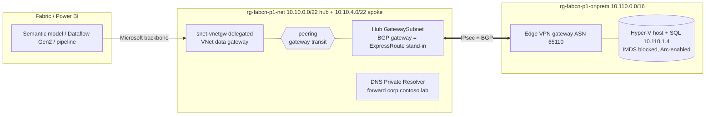

# Pattern 1 - VNet data gateway over ExpressRoute (hub & spoke)

| | |
|---|---|
| Deploy | `..\Deploy-Pattern.ps1 -Pattern 1` or `.\deploy.ps1` or `.\azd-init.ps1; azd up` |
| Real ExpressRoute | `-HybridLinkMode expressRoute [-ExpressRouteCircuitId <id> -ExpressRouteAuthorizationKey <key>]` (see [docs/03](../docs/03-simulating-expressroute.md)) |
| Test | `..\common\scripts\Test-Pattern.ps1 -Pattern 1` |
| Fabric | `..\common\scripts\Fabric-Configure.ps1 -Pattern 1 [-CapacityId <guid>] [-SqlPassword <secure>]` creates the workspace and, when the API allows, the VNet data gateway + SQL connection; otherwise prints the portal steps |
| Resource groups | `rg-fabcn-p1-{net,onprem,gov,fabric}-dev-eus2` |
| Check after deploy | server `sql01.corp.contoso.lab` (resolves to 10.110.1.4), database `OnPremSalesDemo`, login `fabricsvc` (secret in Key Vault / `.secrets`) |
