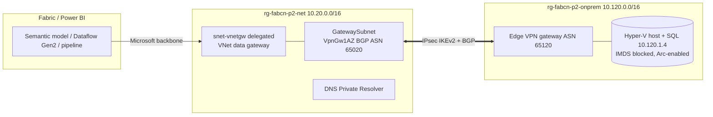

# Pattern 2 - VNet data gateway over Site-to-Site VPN (single VNet)

| | |
|---|---|
| Deploy | `..\Deploy-Pattern.ps1 -Pattern 2` or `.\deploy.ps1` or `.\azd-init.ps1; azd up` |
| Test | `..\common\scripts\Test-Pattern.ps1 -Pattern 2` (tunnel, BGP, Arc, DNS, TCP 1433) |
| Fabric | `..\common\scripts\Fabric-Configure.ps1 -Pattern 2 ...` (same as pattern 1) |
| Bring your own device | set `deployVpnDevice` false in the site call and add a local network gateway + connection for your real device |
| Resource groups | `rg-fabcn-p2-{net,onprem,gov,fabric}-dev-eus2` |
