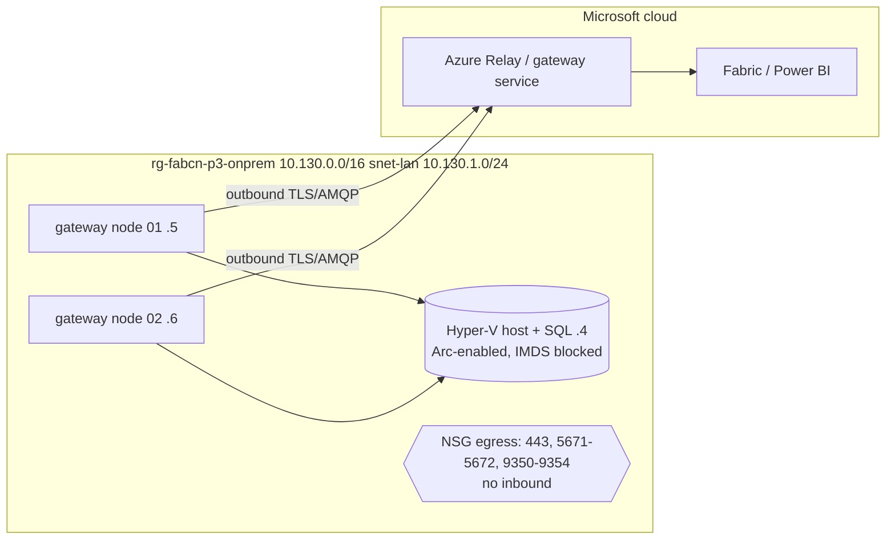

# Pattern 3 - On-premises data gateway (outbound only)

| | |
|---|---|
| Deploy | `..\Deploy-Pattern.ps1 -Pattern 3` (about 10 min, no gateways) or `.\azd-init.ps1; azd up` |
| Test | `..\common\scripts\Test-Pattern.ps1 -Pattern 3` (Arc/non-Azure for 3 hosts) |
| Gateway install | interactive: `..\common\scripts\Install-OnPremGateway.ps1 -GatewayName gw-fabcn-p3-dev` on node 01, `-JoinExisting` on node 02 (see [docs/05](../docs/05-post-deployment-testing-cost.md)) |
| SQL for the connection | server `10.130.1.4`, database `OnPremSalesDemo`, login `fabricsvc` |
| Resource groups | `rg-fabcn-p3-{onprem,gov,fabric}-dev-eus2` (no Azure network by design) |
| Optional hardening | add a deny-internet outbound rule after the allow rules; use Fabric Private Link for user access |
