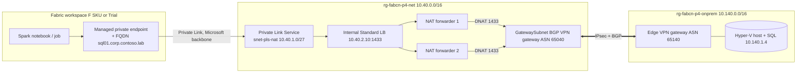

# Pattern 4 - Managed private endpoint + Private Link Service

| | |
|---|---|
| Deploy | `..\Deploy-Pattern.ps1 -Pattern 4` or `.\azd-init.ps1; azd up` (`-HybridLinkMode expressRoute` for a real ER gateway) |
| Test network | `..\common\scripts\Test-Pattern.ps1 -Pattern 4` |
| Create + approve the endpoint | `..\common\scripts\Fabric-Configure.ps1 -Pattern 4 [-CapacityId <guid>]`: creates workspace, `POST /managedPrivateEndpoints` with the PLS id and FQDN, approves the pending PLS connection |
| End-to-end proof | `..\common\scripts\Test-FabricSpark.ps1 -WorkspaceId <guid> -SqlPassword <secure>` runs a notebook that reads `dbo.Orders` (5000 rows) through the endpoint |
| PLS visibility | defaults to `*` with manual approval (the Fabric requester subscription is not published); tighten via `plsVisibilitySubscriptions` |
| Notes | workspaces with managed private endpoints need a custom Spark pool; delete the endpoint before deleting the workspace |
| Resource groups | `rg-fabcn-p4-{net,onprem,gov,fabric}-dev-eus2` |
