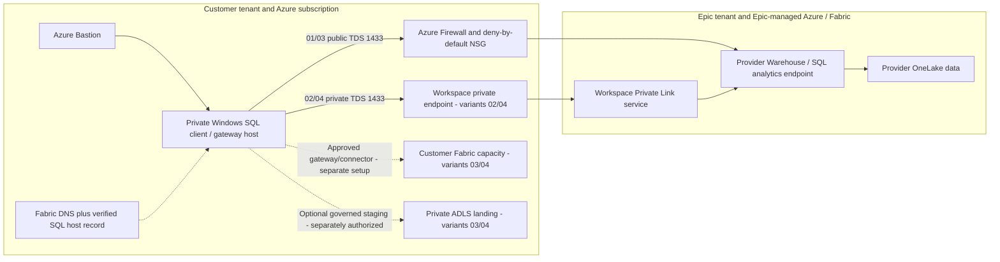

# Architecture analysis and deployment decisions

## Evidence and assumptions

Analysis date: **2026-10-16**. Epic is assumed to own the Entra tenant, Fabric
workspace, Warehouse/SQL analytics endpoint, capacity, and upstream Cogito ingestion.
The customer owns a different Entra tenant and its Azure subscription. These are
design assumptions, not observations of either organization's live environment.

| Repository evidence | Interpretation used here |
|---|---|
| `Fabric-Cogito-Cross-Tenant-Access.md` | The strongest detailed source for the special SQL mapping mechanism: guest consent, provider projections, item `Read`, SQL grants, generated endpoint, and provider preview prerequisites. |
| `Cross-Tenant-Authorization-and-MFA.md`, `04-cross-tenant-mfa-enforcement.svg`, workshop plan | Home-tenant human policy and provider authorization are separate gates. Application tokens do not perform human MFA. Revocation does not necessarily terminate existing sessions. |
| `01-tenant-architecture.svg`, `02-physical-deployment.svg`, `03-implementation-swimlane.svg` | Ownership, Microsoft-operated SaaS placement, and consent-before-mapping sequence. |
| `Customer-Composite-Architecure-Azure-AWS.png`, readable connectivity PDF | Customer Azure landing zone, provider SQL endpoint, on-premises edge, and AWS/hybrid context. Hybrid connectivity is an adjunct, not proof of Fabric access. |
| `Customer-Accessing-Copic-in-Epic-Tenant.png`, `Cogito-to-Azure-CrossTenantArchitecture.png` | Azure clients/private endpoints without requiring a customer Fabric deployment. PHI controls shown are requirements, not compliance certification. |
| `Secure-Cross-Tenant-Arch-PHI-Controls-and-Implementation.png` | Reverses the resource/consumer roles: Epic users access customer-hosted Fabric. That is a separate, reverse-direction collaboration, not automatic reciprocal access. It is excluded from this implementation's fixed Epic-provider data path. |
| `One-Page-Arch-Epic-Cogito-Fabric-2-Azure-Fabric.png`, `Fabric-on-Azure-2-Fabric-on-Cogito-Architecture.png`, `Fabric-Epic-Cogito-CrossTenantArch-and-Implementation.png` | A second consumer topology: customer-owned Fabric and ingestion/analytics. A new data copy creates customer governance obligations. Some arrows/labels mix B2B and special SQL mapping, so they are not treated as API contracts. |
| Both `.pptx` files and `microsoft_fabric_cross_tenant_access_epic_cogito_provider_20261015_052501.pdf` | Rights-protected Office/encrypted containers or a protected-document notice, not readable architecture content in this environment. No decryption or protection bypass attempted; their unseen contents are not evidence. |

The four combinations follow a **2 x 2 matrix**, not four names for the same trust:

| | Public SQL data path | Private SQL data path |
|---|---|---|
| **Customer Azure only** | **01**: controlled interactive/query client | **02**: controlled client with approved workspace private endpoint |
| **Customer Azure + Fabric** | **03**: customer analytics capacity plus ingestion-host foundation | **04**: same with an approved private provider SQL path |

For each, the source stays in Epic-managed Fabric. SQL result sets cross into the
client. Combinations 03/04 permit an explicitly approved copy into the customer's
analytics environment; neither implies replication, a OneLake shortcut, or a
provider-supported unattended connector merely because capacity was deployed.

## Selected implementation

Arrows express logical connectivity, not the physical hosting of Fabric in the
customer VNet. F capacity is an Azure billing/control resource; Warehouse engines,
OneLake, workspaces, and Fabric pipelines remain Microsoft-managed SaaS. The
gateway host's network does not automatically become the network of Fabric SaaS.

### Common customer foundation

All variants create a private Windows Server 2022 Trusted Launch VM, Azure Bastion
Standard, Azure Firewall Standard with a policy, a VNet, NSG, routes, and a 90-day
Log Analytics workspace. No VM public IP, inbound public RDP, SQL server VM, or
native SQL passwords are created. Local Windows administrator credentials come
from an existing deployment-enabled Key Vault; they are **not** Fabric credentials.

A private IPv4 `/16` is divided into `/24` client, endpoint, firewall, and Bastion
subnets (indexes 0-3). The endpoint subnet has room for Fabric's multi-IP endpoint
and optional storage endpoints. Workload Internet traffic follows an explicit
default route to the firewall; implicit default outbound access is disabled.
Platform DNS, VM agent/metadata, activation, and private service ports are explicit.
The VM NIC uses the firewall's DNS proxy, allowing its network FQDN rules and
linked private zones to use the same resolver rather than guessing firewall IPs.

Public variants permit TCP 1433 to approved Power BI and SQL service tags. These are
network rules, **not HTTPS on port 1433**. Example global tags are a pilot baseline;
regional tightening needs Epic's real home/capacity/recovery region inventory.
HTTPS goes only to configured destinations. Windows servicing uses Microsoft's
managed `WindowsUpdate` FQDN tag, which can also require HTTP 80; the NSG permits
80/443 to the firewall-controlled Internet path, not arbitrary direct web egress.

Private variants have **no public TCP 1433 allow rule** at either firewall or NSG.
Their provider data path is restricted to the endpoint subnet. Authentication,
gateway relay, management, and updates still need approved public service
connectivity; "private SQL" is not "every control plane disconnected."

Firewall, Bastion, and optional blob-service logs go to Log Analytics. This does not
automatically export Entra sign-ins, Purview events, or provider SQL audit records.
Monitor query/ingestion endpoints remain public with Azure authorization; this
reference is not an Azure Monitor Private Link Scope deployment.

### Provider/customer separation for Private Link

The provider deploys `shared/provider/main.bicep` independently in its own tenant.
It creates the documented
`Microsoft.Fabric/privateLinkServicesForFabric@2024-06-01`, `location: global`,
with the current provider tenant ID and an **existing** workspace ID. This is not a
customer load balancer-backed `Microsoft.Network/privateLinkServices` resource.
The template does not create an Epic workspace or capacity, or change tenant policy.

The customer points a **manual** private endpoint request at that ARM resource ID
using group `workspace`. Epic must approve it. `privateConnectivityApproved=true`
is required at the private entry points as an explicit design sign-off; it does
not auto-approve the pending endpoint and does not claim runtime success.

`privatelink.fabric.microsoft.com` and its VNet link/zone group are provisioned.
The SQL-specific connection name/IP is a **post-approval handoff**: the workspace
documentation says the Warehouse FQDN is not included in the endpoint DNS
configuration. The separate `shared/consumer-sql-dns` template creates a host-only
zone and apex A record for the **actual provider-returned SQL hostname** and the
verified endpoint SQL-member IP. It never invents a tenant/workspace hostname or
assumes the first NIC IP is SQL. Manage IP changes after endpoint replacement.
Use existing central DNS ownership instead of deploying duplicate zones in a hub.

### Customer Fabric additions

03/04 deploy a customer-owned F capacity, not Epic's capacity. F2 is only a small
synthetic-pilot example; F64 is not assumed necessary for SQL consumption, and
Power BI distribution/licensing needs a separate sizing decision.

They also deploy private ADLS Gen2 with blob and DFS private endpoints, public and
shared-key access disabled, ZRS, infrastructure encryption, 30-day soft deletion,
and blob logs. An optional **customer-tenant service principal object ID** receives
Storage Blob Data Contributor on the `landing` container only. Empty means no
data-plane grant; the Windows host receives no automatic provider or storage role.
The optional staging store is not the storage account behind OneLake.

The VM can host an approved standard-mode on-premises data gateway after managed
installation/registration. It is not an ADF self-hosted integration runtime or a
Fabric VNet data gateway. Use a separate gateway cluster/host design and recovery
key custody for production; a single pilot VM is not highly available.

Fabric workspaces, capacity assignment, lakehouses, connections, gateway
registration, and copy/refresh schedules are **not ARM resources in these
templates**. Create them through supported Fabric administration after deployment.
The native Warehouse connector advertises organizational-account authentication;
the SQL Server connector's service-principal support is documented only for SQL
Server on Azure VMs. Neither is proof that the special cross-tenant Warehouse
mapping works in an unattended Fabric job. Validate the exact connector, endpoint,
tenant/audience, gateway, auth/refresh mode, and provider MFA requirement before
approving ingestion. Do not substitute SQL passwords or a guessed managed identity.
If that path is not supported, keep 01/02 for SQL access until Epic/Microsoft
approve a separate extraction/landing integration; capacity alone is not a workaround.

## Identity, data access, and governance

**Use one identified identity mechanism per connection.** The baseline is the
repository's special Fabric SQL flow: guest-owned identities, guest consent,
Fabric-managed provider projections, item `Read`, and curated-view SQL grants.
Do not create B2B guests or broad reciprocal trust as an automatic substitute.
If Epic supplies a different B2B collaboration design, validate its own supported
client and CA behavior independently.

For humans, verify home Conditional Access across the documented Fabric resources
and provider outside-organization MFA behavior, using actual sign-in evidence.
For ingestion workloads, explicitly approve noninteractive authentication; do not
describe workload access as human MFA. The templates intentionally do not mutate
organization-wide CA, MFA, first-party apps, Graph permissions, or consent.

Customer-owned copies require approved data minimization, location, retention,
classification, lineage, DLP, export restrictions, and legal/security agreements.
Soft deletion is recovery protection, not a PHI retention/deletion policy. Managed
encryption, isolation, and logging alone do not certify HIPAA compliance. Customer-
managed keys, Sentinel/Purview configuration, ExpressRoute/VPN, on-premises DNS
forwarding, and AWS networking are not fabricated from the conceptual drawings.
They must attach to the customer's real landing-zone and governance architecture.

## Reconciliation with the earlier research

The root report correctly warned that a connection-string option alone does not
prove a cross-tenant private network. More specific Microsoft guidance now
**explicitly documents cross-tenant workspace-level Private Link**, including
provider-owned service, customer-owned endpoint, provider approval, and DNS.
The tenant-level overview still says its path does not enable cross-tenant
connectivity. These are different scopes; use the workspace-specific procedure.

That establishes a network architecture, **not** automatic compatibility between
every SQL identity mapping, connector, session policy, and item security model.
Confirm the combined guest-specific SQL + workspace Private Link path in the
synthetic pilot, and retain the root workshop's identity/session acceptance gates.
Do not generalize this design to private cross-tenant OneLake shortcuts.

## Authoritative references

Microsoft Learn HTML was unreachable from this environment; the corresponding
public `MicrosoftDocs/fabric-docs` Markdown sources were read directly on GitHub.
The citations below identify the authoritative pages and relevant source files;
capabilities and preview conditions still require confirmation at deployment time.

- [Guest SQL setup](https://learn.microsoft.com/en-us/fabric/enterprise/cross-tenant-access)
  and [provider SQL setup](https://learn.microsoft.com/en-us/fabric/enterprise/cross-tenant-access-for-providers);
  source `docs/enterprise/cross-tenant-access-for-providers.md`.
- [Cross-tenant workspace Private Link](https://learn.microsoft.com/en-us/fabric/security/security-cross-tenant-communication);
  [source](https://github.com/MicrosoftDocs/fabric-docs/blob/main/docs/security/security-cross-tenant-communication.md).
- [Workspace setup and exact provider ARM contract](https://learn.microsoft.com/en-us/fabric/security/security-workspace-level-private-links-set-up);
  [source](https://github.com/MicrosoftDocs/fabric-docs/blob/main/docs/security/security-workspace-level-private-links-set-up.md)
  and `docs/security/includes/create-private-link-service.md`.
- [Workspace overview / SQL DNS caveat](https://learn.microsoft.com/en-us/fabric/security/security-workspace-level-private-links-overview)
  and [item support and limitations](https://learn.microsoft.com/en-us/fabric/security/security-workspace-level-private-links-support).
- [Tenant-level Private Link](https://learn.microsoft.com/en-us/fabric/security/security-private-links-overview),
  to distinguish tenant restrictions and OneLake-sharing limitations.
- [Warehouse connectivity](https://learn.microsoft.com/en-us/fabric/data-warehouse/connectivity),
  especially TDS 1433, SQL authentication, and Power BI/SQL service tags.
- [Warehouse connector capabilities](https://learn.microsoft.com/en-us/fabric/data-factory/connector-data-warehouse-overview)
  and [SQL Server connector capabilities](https://learn.microsoft.com/en-us/fabric/data-factory/connector-sql-server-database-overview),
  especially supported gateway and authentication combinations.
- [Azure Firewall FQDN tag port behavior](https://learn.microsoft.com/en-us/azure/firewall/fqdn-tags),
  including Microsoft-managed Windows Update HTTP dependencies.
